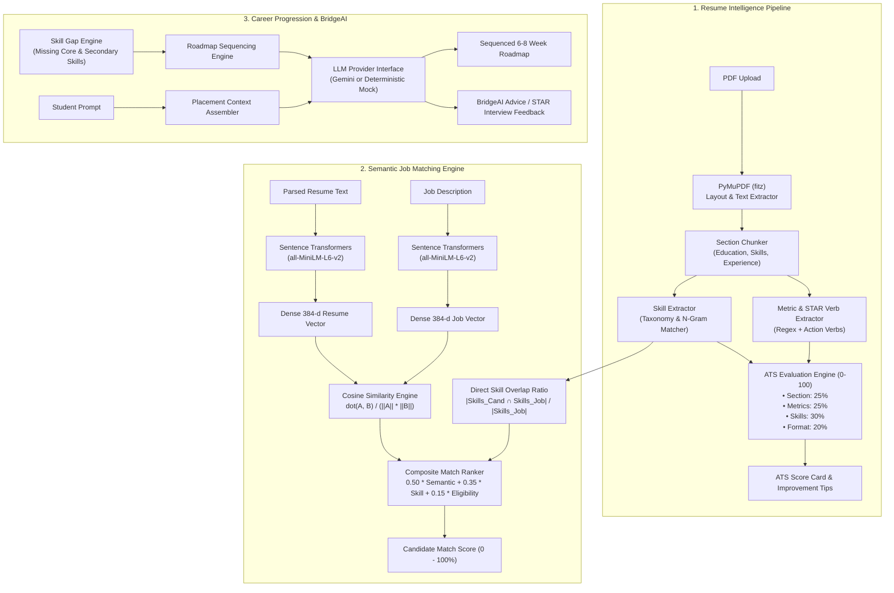

# CareerBridge — AI & Machine Learning Architecture

> **Design Philosophy:** Hybrid AI Pipeline.  
> Avoid over-reliance on slow/costly external generative APIs where deterministic rules and local embeddings produce superior accuracy, zero marginal cost, and sub-second latency. Deploy LLMs selectively for nuanced conversational reasoning and personalized feedback.

---

## 1. AI Capability Distribution Matrix

CareerBridge splits AI tasks across three distinct tiers according to computational cost, determinism, and latency requirements:

| AI Sub-Module | Primary Technique | Technology / Framework | Latency Target | Requires Paid API? |
| :--- | :--- | :--- | :---: | :---: |
| **1. Resume Parsing** | Deterministic Layout & Rule-Based OCR/Text Extraction | `PyMuPDF` (`fitz`), Regex, Layout Chunking | < 250ms | ❌ No (100% Local) |
| **2. Skill Extraction** | Normalized Token & N-Gram Extraction + Taxonomy Lookup | Custom Taxonomy Index, SpaCy tokenization | < 100ms | ❌ No (100% Local) |
| **3. Resume ATS Scoring** | Multi-Factor Quantifiable Rubric | Deterministic Algorithm, Regex pattern engine | < 150ms | ❌ No (100% Local) |
| **4. JD Parsing** | Rule & Named Entity Extraction | Custom Section Segmenter, Taxonomy Matcher | < 120ms | ❌ No (100% Local) |
| **5. Job Matching** | Dense Semantic Vectors + Cosine Similarity | `sentence-transformers/all-MiniLM-L6-v2`, Scikit-learn | < 80ms | ❌ No (100% Local) |
| **6. Skill Gap Analysis** | Set Delta & Topological Competency Graph | Graph / Set Theory Algorithm | < 50ms | ❌ No (100% Local) |
| **7. Career Roadmap** | Hybrid Heuristic Sequencing + Generative Enhancement | Graph Pathfinding + Gemini 1.5/2.0 API (with Mock Fallback) | < 1.5s | ⚠️ Optional (Works with local templates) |
| **8. BridgeAI Chatbot** | Retrieval-Augmented Context + Generative LLM | Google Gemini Flash / Pro (with Mock Fallback) | < 1.8s | ⚠️ Yes / Fallback to Mock |
| **9. Interview Simulator** | Contextual Prompting & STAR Scoring Rubric | Google Gemini + Deterministic Rubric Scoring | < 2.0s | ⚠️ Yes / Fallback to Mock |

---

## 2. Detailed AI Pipelines & Module Specifications



---

## 3. Resume Parser, Skill Extraction & ATS Scoring

### A. PyMuPDF Layout & Text Extraction
1. `fitz.open(stream=pdf_bytes, filetype="pdf")` parses pages into text blocks.
2. Blocks are sorted by `(y0, x0)` to preserve linear reading order across single- and multi-column resumes.
3. Font sizes and bold flags identify section boundaries (`EDUCATION`, `EXPERIENCE`, `SKILLS`, `PROJECTS`).

### B. Skill Extraction Engine
A curated taxonomy of 800+ standardized skills across:
- **Languages:** Python, Java, C++, TypeScript, Go, Rust, SQL, etc.
- **Frameworks:** React, Next.js, FastAPI, Django, Spring Boot, Node.js, Express, etc.
- **Databases:** MySQL, PostgreSQL, MongoDB, Redis, Cassandra.
- **Cloud & DevOps:** AWS, Azure, Docker, Kubernetes, CI/CD, Git, Linux.
- **Data & AI:** NumPy, Pandas, Scikit-learn, TensorFlow, PyTorch, PyMuPDF.

Extraction utilizes tokenization, lowercasing, and sliding n-grams ($n \in \{1, 2, 3\}$) to capture multi-word skills like *"Machine Learning"*, *"Spring Boot"*, or *"Next.js"*.

### C. ATS Scoring Rubric (100-Point Formula)

$$\text{ATS Score} = S_{\text{sections}} + S_{\text{metrics}} + S_{\text{skills}} + S_{\text{formatting}}$$

1. **Section Completeness ($S_{\text{sections}} \in [0, 25]$):**
   - Contact Info (Email, Phone, LinkedIn/GitHub): 5 pts.
   - Education Section with Degree & Year: 5 pts.
   - Work Experience / Internships: 5 pts.
   - Technical Skills Section: 5 pts.
   - Substantial Projects with Tech Stack: 5 pts.

2. **Quantifiable Impact & STAR Action Verbs ($S_{\text{metrics}} \in [0, 25]$):**
   - Matches bullet points against high-impact action verbs (e.g., *Architected, Implemented, Optimized, Reduced, Increased, Automated*).
   - Counts presence of numerical metrics (%, \$, ms, scaling figures, user counts).
   - $\ge 4$ metric-driven bullets: 25 pts; 2-3 bullets: 15 pts; 1 bullet: 10 pts; 0 bullets: 0 pts.

3. **Skill Density & Domain Relevance ($S_{\text{skills}} \in [0, 30]$):**
   - Evaluates ratio of recognized technical skills to total word count.
   - Benchmark: 12-25 distinct validated skills across categorized competencies.

4. **Formatting & Length Hygiene ($S_{\text{formatting}} \in [0, 20]$):**
   - Word count in target range (350 - 750 words for 1 page): 10 pts.
   - Clean UTF-8 encoding with no unreadable ligature artifacts: 5 pts.
   - Proper email and phone format validation: 5 pts.

---

## 4. Semantic Job Matching Engine

Instead of relying on basic keyword search, CareerBridge computes dense vector similarity:

1. **Embedding Model:** `sentence-transformers/all-MiniLM-L6-v2` produces a 384-dimensional dense vector representing the semantic meaning of the candidate resume and job descriptions.
2. **Dense Vector Storage:** Vectors are stored as base64-encoded float32 arrays or JSON arrays in MySQL `resumes.embedding_vector` and `jobs.jd_embedding`.
3. **In-Memory Matching:** Active job vectors are held in an in-memory NumPy matrix for instant matrix multiplication:

$$\text{Cosine Similarity} = \frac{\mathbf{u} \cdot \mathbf{v}}{\|\mathbf{u}\|_2 \|\mathbf{v}\|_2}$$

4. **Composite Match Score Formula:**

$$\text{Match Score} = 0.50 \times (\text{Cosine Sim} \times 100) + 0.35 \times (\text{Skill Overlap Ratio} \times 100) + 0.15 \times (\text{Eligibility Score})$$

Where $\text{Eligibility Score} = 100$ if student satisfies CGPA, graduation year, and department requirements; $0$ if gated.

---

## 5. Skill Gap Analyzer & Learning Roadmap Generator

### Algorithm:
1. **Inputs:**
   - Student's verified skills: $S_{\text{student}}$
   - Target Job / Role benchmark skills: $S_{\text{target}} = S_{\text{mandatory}} \cup S_{\text{preferred}}$
2. **Set Operations:**
   - **Matched:** $S_{\text{matched}} = S_{\text{student}} \cap S_{\text{target}}$
   - **Critical Gap:** $S_{\text{gap\_crit}} = S_{\text{mandatory}} \setminus S_{\text{student}}$
   - **Secondary Gap:** $S_{\text{gap\_sec}} = S_{\text{preferred}} \setminus S_{\text{student}}$
3. **Readiness Percentage:**
   $$\text{Readiness} = \frac{|S_{\text{matched}} \cap S_{\text{mandatory}}| + 0.5 \times |S_{\text{matched}} \cap S_{\text{preferred}}|}{|S_{\text{mandatory}}| + 0.5 \times |S_{\text{preferred}}|} \times 100$$
4. **Roadmap Sequencing:**
   - Builds a dependency graph (e.g., Python Basics $\rightarrow$ SQL $\rightarrow$ FastAPI $\rightarrow$ Docker).
   - Generates a structured 6-8 week weekly progression with learning resources, official documentation links, and portfolio project suggestions.

---

## 6. BridgeAI Career Assistant & Mock Interview Simulator

### LLM Provider Abstraction
To ensure CareerBridge is fully functional in development, offline, or enterprise environments without paid API dependencies:

```python
class BaseLLMProvider(ABC):
    @abstractmethod
    async def generate_response(self, prompt: str, system_prompt: str, temperature: float = 0.7) -> LLMResult:
        pass

class GeminiLLMProvider(BaseLLMProvider):
    """Production provider using Google Gemini API."""
    pass

class MockLLMProvider(BaseLLMProvider):
    """Deterministic, high-quality offline provider with structured fallbacks."""
    pass
```

### Distinction Between Real and Mock Outputs:
- All LLM responses carry metadata:
  ```json
  {
    "provider": "google_gemini_pro" | "offline_mock_engine",
    "is_mock": true | false,
    "model": "gemini-1.5-flash" | "rule-based-mock-v1"
  }
  ```
- The frontend displays a subtle badge `Demo AI Engine` if running in mock mode, maintaining complete developer and user transparency.

### Mock Interview STAR Rubric:
When a student answers an interview question, the response is evaluated on:
1. **Situation:** Did the student clearly describe the context and background?
2. **Task:** What was their specific responsibility?
3. **Action:** What technical or interpersonal steps did they execute?
4. **Result:** What was the measurable outcome, metric, or learning?

