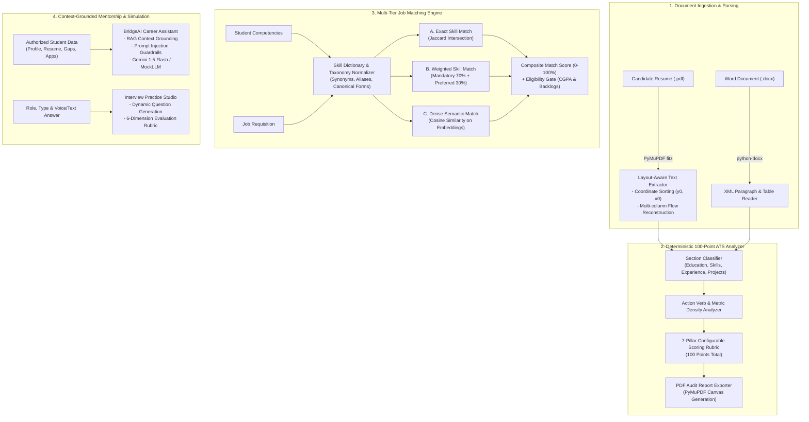

# CareerBridge — AI & Machine Learning Implementation Specification

> **Platform Version:** 1.0.0  
> **Core AI Stack:** PyMuPDF (`fitz`), Python-docx, Scikit-learn, Sentence Transformers, Google Gemini API (with offline `MockLLMProvider` fallback)  
> **Guiding Principle:** Deterministic mathematical algorithms prioritized over ungrounded LLM guessing; transparent scoring formulas with zero hallucinated ATS guarantees.

---

## 1. Architectural Overview of AI Systems



---

## 2. ATS Resume Analyzer & Scoring Rubric

### 2.1 Multi-Column Layout Extraction (PyMuPDF)
Standard text extraction often flattens two-column resumes into garbled sentences. CareerBridge solves this by extracting bounding-box layout coordinates from each text block:

```python
# PyMuPDF coordinate sorting
blocks = page.get_text("blocks")
# Sort blocks primarily by column band (x0 // column_width), then vertically by y0
sorted_blocks = sorted(blocks, key=lambda b: (round(b[0] / 200) * 200, b[1]))
```

### 2.2 Transparent 7-Pillar Scoring Formula
The resume analysis is computed deterministically out of 100 points across 7 weighted dimensions:

$$\text{ATS Score} = W_{\text{struct}} + W_{\text{skills}} + W_{\text{proj}} + W_{\text{exp}} + W_{\text{edu}} + W_{\text{achieve}} + W_{\text{read}}$$

| Dimension | Default Weight | Evaluation Criteria |
| :--- | :---: | :--- |
| **Structure & Formatting** | **15 pts** | Header hierarchy, contact info completeness (email, phone, LinkedIn, GitHub), standard section naming. |
| **Technical Skills** | **20 pts** | Quantity, variety, and clustering of verified developer tools, languages, and frameworks. |
| **Engineering Projects** | **20 pts** | Number of substantive projects ($\ge 2$), presence of live URLs / GitHub links, and tech stack tags. |
| **Experience / Internships** | **15 pts** | Chronological work or open source internships with duration, organization names, and responsibilities. |
| **Academic Background** | **10 pts** | Degree, institution, department, graduation year, and GPA/percentage notation. |
| **Achievements & Certs** | **10 pts** | Accredited cloud/engineering certifications, academic honors, or hackathon awards. |
| **Readability & Metrics** | **10 pts** | Action verb density, quantifiable impact metrics ($\%$, $\$$, numbers), and absence of typographical noise. |

*Disclaimer:* CareerBridge explicitly notifies students that this score reflects structured formatting best practices and does not guarantee employer shortlisting.

---

## 3. Intelligent Job Matching Engine

### 3.1 Skill Dictionary & Normalization
To prevent false negatives (e.g. "ReactJS" vs "React.js"), incoming skills are passed through a curated canonical dictionary:

```python
SKILL_SYNONYMS = {
    "js": "JavaScript",
    "javascript": "JavaScript",
    "react": "React",
    "reactjs": "React",
    "react.js": "React",
    "ml": "Machine Learning",
    "machine learning": "Machine Learning",
    "nlp": "Natural Language Processing",
    "k8s": "Kubernetes",
    "postgres": "PostgreSQL",
    "postgresql": "PostgreSQL",
    "fastapi": "FastAPI",
    "aws": "Amazon Web Services",
}
```

### 3.2 Hybrid Tri-Tier Matching Formula
The composite job match score $S_{\text{match}}$ blends three complementary matching algorithms:

$$S_{\text{match}} = 0.40 \cdot S_{\text{exact}} + 0.35 \cdot S_{\text{weighted}} + 0.25 \cdot S_{\text{semantic}}$$

1. **Exact Skill Matching ($S_{\text{exact}}$):**
   $$S_{\text{exact}} = \frac{|S_{\text{student}} \cap S_{\text{required}}|}{|S_{\text{required}}|} \times 100$$
2. **Weighted Skill Matching ($S_{\text{weighted}}$):**
   Separates core requirements (weight 0.70) from preferred bonuses (weight 0.30):
   $$S_{\text{weighted}} = \left(0.70 \cdot \frac{|S_{\text{cand}} \cap S_{\text{core}}|}{|S_{\text{core}}|} + 0.30 \cdot \frac{|S_{\text{cand}} \cap S_{\text{pref}}|}{|S_{\text{pref}}|}\right) \times 100$$
3. **Dense Semantic Embedding ($S_{\text{semantic}}$):**
   Encodes the student's project descriptions and the employer's job description into high-dimensional vector space, computing Cosine Similarity:
   $$S_{\text{semantic}} = \frac{\mathbf{u} \cdot \mathbf{v}}{\|\mathbf{u}\| \|\mathbf{v}\|} \times 100$$

### 3.3 Strict Academic Eligibility Gate
Even if a student achieves a 95% skill match, they are flagged as `ineligible` if:
- Candidate CGPA $<$ Requisition Minimum CGPA Cutoff.
- Candidate Active Backlogs $>$ Requisition Allowed Backlogs.
- Candidate Department $\notin$ Requisition Allowed Departments.

---

## 4. BridgeAI: Context-Aware Career Assistant

### 4.1 RAG (Retrieval-Augmented Generation) Architecture
BridgeAI never answers student queries in isolation. On every chat request, the backend automatically retrieves:
- The authenticated student's profile, verified skills, and academic history.
- Extracted resume summary and ATS rubric findings.
- Active job applications and their pipeline stages.
- Diagnosed skill gaps and current roadmap week.

### 4.2 Privacy & Security Isolation
- **Tenant Isolation:** Queries strictly filter by `student_id = current_user.id`. BridgeAI has no access to peer student records or corporate recruiter confidential notes.
- **Prompt Injection Defense:** Input is sanitized against role-reversal attacks ("Ignore previous instructions..."). System prompts enforce a strict career mentor persona.

```
SYSTEM PROMPT (Excerpt):
You are BridgeAI, a personalized career mentor for {student_name} at {institution}.
You have access ONLY to the authorized student profile provided in the context below.
Never invent jobs or claim guaranteed job placements.
Always provide constructive, actionable, and encouraging feedback.
```

### 4.3 Deterministic Fallback (`MockLLMProvider`)
To ensure reliable local development and CI/CD testing without external API dependencies or rate limits, CareerBridge implements an offline `MockLLMProvider` that returns structured, deterministic responses whenever `GEMINI_API_KEY` is omitted or unconfigured.

---

## 5. AI Interview Preparation Studio

1. **Domain Question Synthesis:**
   Generates targeted practice questions across 5 tracks (Technical, Coding, HR, Behavioral, Aptitude) tailored to the student's target job role and difficulty setting.
2. **Speech-to-Text Pipeline:**
   Leverages browser-native `webkitSpeechRecognition` / `SpeechRecognition` to transcribe audio streams locally with zero latency, passing the resulting text to the evaluation engine.
3. **6-Dimension Evaluation Rubric:**
   Answers are graded out of 100 points across:
   - Technical Correctness (25%)
   - Problem Solving & Depth (20%)
   - Communication & Structure (20%)
   - Role Relevance (15%)
   - Conciseness & Clarity (10%)
   - Actionable Follow-Up Suggestions (10%)

