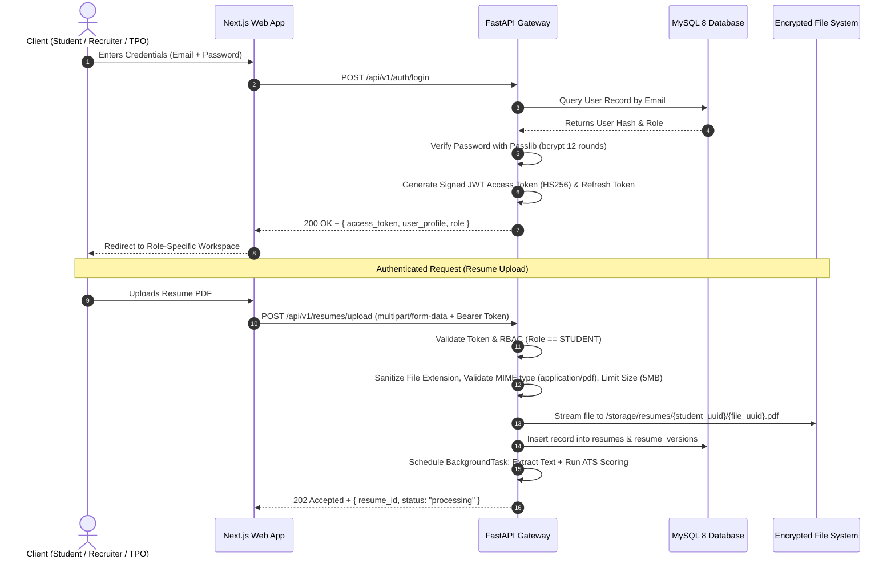

# CareerBridge — End-to-End System Architecture

> **Tagline:** *From Potential to Placement.*  
> **Platform Version:** 1.0.0 Architecture Blueprint  
> **Target Audience:** Engineering Leads, DevOps, Product Architects, Security Auditors

---

## 1. System Overview & Core Objectives

CareerBridge is an enterprise-grade campus placement and career acceleration platform connecting three primary stakeholders:
1. **Students:** Discover verified jobs, receive ATS resume optimization, run semantic match scoring, analyze skill gaps, generate multi-week learning roadmaps, interact with BridgeAI, and practice with mock interview sessions.
2. **Recruiters:** Publish institutional job descriptions, automate applicant screening with semantic matching, manage candidate pipelines via Kanban workflows, and schedule interviews.
3. **Placement Officers (TPOs):** Manage batch records, review recruiter credentials, approve job openings, orchestrate multi-round on-campus placement drives, broadcast notifications, and analyze macro cohort placement metrics.

---

## 2. High-Level Modular Architecture

The platform adopts a decoupled, modular service-oriented architecture centered around a **Next.js Frontend (BFF + Client SPA)**, a **FastAPI Asynchronous REST Gateway**, an **Embedded AI/ML Services Engine**, a **MySQL 8 Relational Database**, an **Asynchronous Task Worker Queue**, and a **Secure File Storage Layer**.

```mermaid
graph TB
    subgraph ClientLayer ["Client Presentation Layer (Next.js 14 / TypeScript)"]
        SW["Student Workspace<br/>(Dashboard, ATS, Matching, Roadmaps)"]
        RW["Recruiter Workspace<br/>(Job Studio, Applicant Pipeline, Interviews)"]
        PW["Placement Officer Workspace<br/>(Drive Manager, Analytics, Cohorts)"]
        UIComponents["Design System & UI Components<br/>(Tailwind CSS, Framer Motion, Recharts)"]
    end

    subgraph GatewayAuth ["Gateway & Security Layer"]
        ReverseProxy["Reverse Proxy / Nginx / Cloudflare"]
        FastAPIGateway["FastAPI REST Application (ASGI / Uvicorn)"]
        AuthMiddleware["JWT Authentication & RBAC Filter"]
        RateLimiter["Rate Limiting & Request Sanitization"]
    end

    subgraph ApplicationServices ["Core Application Business Services"]
        StudentService["Student & Profile Service"]
        JobService["Job & Application Service"]
        DriveService["Placement Drive Service"]
        AnalyticsService["Cohort Analytics Service"]
        NotificationService["Notification & Alert Service"]
    end

    subgraph AIEngine ["Embedded AI / ML Engine"]
        ResumeParser["Resume Parser & Text Extractor (PyMuPDF)"]
        ATSScorer["Deterministic ATS Scoring Rubric"]
        SemanticMatcher["Sentence Transformers Embedding & Matcher"]
        SkillGapEngine["Skill Taxonomy & Gap Analyzer"]
        BridgeAIAssistant["BridgeAI & Interview Prep Engine"]
        LLMAdapter["LLM Provider Abstraction<br/>(Google Gemini API / Offline Mock Fallback)"]
    end

    subgraph AsyncWorker ["Background Tasks & Asynchronous Processing"]
        BgTasks["FastAPI BackgroundTasks / Celery Worker"]
        DocConverter["Document Processing & PDF Exporter"]
        EmailNotifier["Email & Webhook Dispatcher"]
    end

    subgraph DataStorage ["Data & Storage Layer"]
        MySQL[("MySQL 8.0 Enterprise Relational DB<br/>(SQLAlchemy 2.0 ORM + Alembic)")]
        LocalMedia["Local Secure File Store / S3 Bucket<br/>(Encrypted Resumes & Artifacts)"]
        InMemoryVectorCache["In-Memory Vector Cache & NumPy Index"]
    end

    %% Communication Flow
    ClientLayer -->|HTTPS / JSON / JWT| ReverseProxy
    ReverseProxy --> FastAPIGateway
    FastAPIGateway --> AuthMiddleware
    AuthMiddleware --> RateLimiter
    RateLimiter --> ApplicationServices

    ApplicationServices --> MySQL
    ApplicationServices --> LocalMedia
    ApplicationServices --> AIEngine
    ApplicationServices --> BgTasks

    AIEngine --> InMemoryVectorCache
    AIEngine --> LLMAdapter
    LLMAdapter -->|Outbound HTTPS (SSL)| ExternalLLM["Google Gemini API (External Cloud)"]

    BgTasks --> EmailNotifier
    BgTasks --> DocConverter
```

---

## 3. Communication Protocols & Component Interaction

| Source | Destination | Protocol / Mechanism | Payload / Purpose |
| :--- | :--- | :--- | :--- |
| **Next.js Client** | **FastAPI Gateway** | HTTPS / REST (JSON) | Bearer JWT in `Authorization` header. State mutations, data queries, file uploads (`multipart/form-data`). |
| **Next.js Client** | **Real-time Updates** | SSE (Server-Sent Events) / Polling | Live notification updates, background processing progress (e.g., resume parsing). |
| **FastAPI Core** | **MySQL 8 Database** | TCP / MySQL Protocol (PyMySQL / aiomysql) | SQLAlchemy 2.0 connection pool (10 base, 20 overflow), parameterized queries, relational integrity. |
| **FastAPI Core** | **AI / ML Engine** | Direct In-Process Python Function Calls | Low-latency local processing. Zero serialization overhead for PyMuPDF, Scikit-learn, and Sentence Transformers. |
| **AI / ML Engine** | **External LLM** | Outbound HTTPS REST | Gemini 1.5/2.0 API with fallback to `MockLLMProvider` (local deterministic fallback engine). |
| **FastAPI Core** | **File Storage** | Local OS I/O or S3 API | Resumes stored with hashed UUID paths (`/storage/resumes/{student_uuid}/{file_uuid}.pdf`). |
| **FastAPI Core** | **Background Tasks** | In-Process Asynchronous Tasks (`asyncio`) | Offloads resume text extraction, dense embedding generation, and audit logging. |

---

## 4. User Roles & Permission Matrix

CareerBridge enforces strict Role-Based Access Control (RBAC) at both the API gateway and service levels. Roles are encoded inside the cryptographically signed JWT payload and validated on every protected endpoint.

### Role Definitions:
- **`STUDENT`:** Campus candidate seeking internships and full-time employment.
- **`RECRUITER`:** Corporate talent acquisition representative posting roles and hiring.
- **`PLACEMENT_OFFICER` (TPO):** University authority managing student eligibility, recruiter credentials, and drive logistics.
- **`ADMIN`:** Superuser handling platform configuration, audit inspections, and tenant administration.

### Comprehensive Permission Matrix:

| Operational Feature | Student | Recruiter | Placement Officer (TPO) | System Admin |
| :--- | :---: | :---: | :---: | :---: |
| **Authentication & Profile Self-Management** | ✅ | ✅ | ✅ | ✅ |
| **Upload & Manage Resumes** | ✅ (Own) | ❌ | 👁️ (Read-only) | ✅ |
| **View ATS Score & Improvement Rubric** | ✅ (Own) | ❌ | 👁️ (Read-only) | ✅ |
| **Browse Active Approved Jobs** | ✅ | ❌ | ✅ | ✅ |
| **Apply to Jobs** | ✅ | ❌ | ❌ | ❌ |
| **View Semantic Job Match Score** | ✅ (Own) | ✅ (For Applicants) | ✅ | ✅ |
| **Skill Gap Analysis & Roadmap Access** | ✅ | ❌ | 👁️ (Read aggregate) | ✅ |
| **BridgeAI Career Chatbot** | ✅ | ❌ | ❌ | ✅ |
| **Mock Interview Practice Simulator** | ✅ | ❌ | ❌ | ✅ |
| **Create & Edit Company Profile** | ❌ | ✅ (Own) | 👁️ (Review) | ✅ |
| **Verify / Approve Company & Recruiter** | ❌ | ❌ | ✅ | ✅ |
| **Post & Manage Job Listings** | ❌ | ✅ | ❌ | ✅ |
| **Approve / Reject Job Listings** | ❌ | ❌ | ✅ | ✅ |
| **View Job Applicants & Resumes** | ❌ | ✅ (Own Jobs) | ✅ (All Campus) | ✅ |
| **Update Applicant Pipeline Status (Kanban)** | ❌ | ✅ (Own Jobs) | ❌ | ✅ |
| **Schedule Interviews & Submit Feedback** | ❌ | ✅ (Own Jobs) | 👁️ (Read-only) | ✅ |
| **View Student Directory & Verify CGPA** | ❌ | ❌ | ✅ | ✅ |
| **Create & Schedule Placement Drives** | ❌ | 👁️ (Register) | ✅ | ✅ |
| **Manage Drive Rounds & Eligibility Criteria** | ❌ | ❌ | ✅ | ✅ |
| **Campus Macro Placement Analytics** | ❌ | ❌ | ✅ | ✅ |
| **Broadcast System & Drive Notifications** | ❌ | ❌ | ✅ | ✅ |
| **Access Audit Logs & Security Metrics** | ❌ | ❌ | ❌ | ✅ |

---

## 5. Security, Authentication & Data Protection Architecture



### Security Guardrails:
1. **Password Storage:** Salted and hashed using `bcrypt` with work factor 12. Plaintext passwords never touch logs or persistent storage.
2. **Token Security:** Short-lived JWT Access Tokens (60-minute expiry) signed with `HS256` secret; Refresh Tokens (7-day expiry) stored securely in HttpOnly cookies or protected storage.
3. **Authorization Checks:** Enforced at the router level using FastAPI `Depends(require_roles(["student"]))`. Handlers check object-level permissions (e.g., a student cannot read another student's resume).
4. **File Validation:** Binary header magic-number verification (`%PDF-`) to prevent file-extension spoofing, with a strict 5 MB file size limit.
5. **No Frontend API Keys:** All third-party LLM and AI keys reside exclusively in backend environment variables (`.env`). The frontend never communicates with Google Gemini directly.

