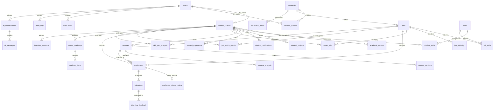

# CareerBridge — Database Design & Schema Specification

> **Database Engine:** MySQL 8.0 Enterprise  
> **ORM Layer:** SQLAlchemy 2.0 (Declarative Base with Typing)  
> **Migration Manager:** Alembic  
> **Character Set / Collation:** `utf8mb4` / `utf8mb4_unicode_ci`  
> **Identifier Strategy:** Standardized UUID v4 (`CHAR(36)`) for high-security domain entities to prevent enumeration attacks, combined with auto-incrementing integers for performance-critical high-write junction/audit logs.

---

## 1. Entity Relationship (ER) Diagram

---

## 2. Table Specifications (Data Dictionary)

---

### Module A: Identity, Authentication & Core Profiles

#### 1. `users`
Central identity repository for all system actors.

| Column Name | Data Type | PK | FK | Constraints | Description |
| :--- | :--- | :---: | :---: | :--- | :--- |
| `id` | `CHAR(36)` | ✅ | - | NOT NULL | UUID v4 primary identifier |
| `email` | `VARCHAR(255)` | - | - | NOT NULL, UNIQUE, INDEX | Official email address |
| `password_hash`| `VARCHAR(255)` | - | - | NOT NULL | Salted bcrypt hash |
| `role` | `ENUM('student','recruiter','tpo','admin')` | - | - | NOT NULL, INDEX | Access control discriminator |
| `is_active` | `BOOLEAN` | - | - | NOT NULL, DEFAULT TRUE | Account state |
| `is_verified` | `BOOLEAN` | - | - | NOT NULL, DEFAULT FALSE | Email verification status |
| `created_at` | `DATETIME` | - | - | NOT NULL, DEFAULT CURRENT_TIMESTAMP | Record creation timestamp |
| `updated_at` | `DATETIME` | - | - | NOT NULL, DEFAULT CURRENT_TIMESTAMP ON UPDATE | Last update timestamp |

- **Relationships:** 1:1 with `student_profiles`, 1:1 with `recruiter_profiles`, 1:N with `notifications`, 1:N with `audit_logs`.

---

#### 2. `student_profiles`
Extended profile for candidate students.

| Column Name | Data Type | PK | FK | Constraints | Description |
| :--- | :--- | :---: | :---: | :--- | :--- |
| `id` | `CHAR(36)` | ✅ | - | NOT NULL | UUID v4 identifier |
| `user_id` | `CHAR(36)` | - | `users.id` | NOT NULL, UNIQUE, ON DELETE CASCADE | Associated user account |
| `full_name` | `VARCHAR(150)` | - | - | NOT NULL, INDEX | Full legal name |
| `roll_number` | `VARCHAR(50)` | - | - | NOT NULL, UNIQUE, INDEX | College registration/roll number |
| `phone_number` | `VARCHAR(20)` | - | - | NULLABLE | Contact telephone |
| `gender` | `ENUM('male','female','other','prefer_not_to_say')` | - | - | NULLABLE | Demographics |
| `bio` | `TEXT` | - | - | NULLABLE | Personal elevator pitch / summary |
| `city` | `VARCHAR(100)` | - | - | NULLABLE | Current location |
| `linkedin_url` | `VARCHAR(255)` | - | - | NULLABLE | LinkedIn public profile link |
| `github_url` | `VARCHAR(255)` | - | - | NULLABLE | GitHub profile link |
| `portfolio_url` | `VARCHAR(255)` | - | - | NULLABLE | Personal portfolio website |
| `placement_status` | `ENUM('unplaced','placed','opted_out')` | - | - | NOT NULL, DEFAULT 'unplaced' | Campus placement status |
| `created_at` | `DATETIME` | - | - | NOT NULL, DEFAULT CURRENT_TIMESTAMP | Registration date |
| `updated_at` | `DATETIME` | - | - | NOT NULL, DEFAULT CURRENT_TIMESTAMP ON UPDATE | Last modified |

- **Relationships:** Belongs to `users`, 1:N with academic records, skills, projects, resumes, and applications.

---

#### 3. `academic_records`
Institutional academic tracking per student semester/degree.

| Column Name | Data Type | PK | FK | Constraints | Description |
| :--- | :--- | :---: | :---: | :--- | :--- |
| `id` | `BIGINT AUTO_INCREMENT` | ✅ | - | NOT NULL | Primary key |
| `student_id` | `CHAR(36)` | - | `student_profiles.id` | NOT NULL, ON DELETE CASCADE, INDEX | Foreign key to student |
| `institution_name` | `VARCHAR(255)` | - | - | NOT NULL | College or high school name |
| `degree` | `VARCHAR(100)` | - | - | NOT NULL | e.g., B.Tech, M.Tech, BCA, MCA |
| `department` | `VARCHAR(100)` | - | - | NOT NULL, INDEX | e.g., Computer Science, Mechanical |
| `start_year` | `INT` | - | - | NOT NULL | Academic start year |
| `end_year` | `INT` | - | - | NOT NULL | Graduation year |
| `cgpa_or_percentage` | `DECIMAL(4, 2)` | - | - | NOT NULL, INDEX | Current cumulative score (0.00 - 10.00) |
| `backlogs_count` | `INT` | - | - | NOT NULL, DEFAULT 0 | Active uncleared backlogs |
| `created_at` | `DATETIME` | - | - | NOT NULL, DEFAULT CURRENT_TIMESTAMP | Created timestamp |

- **Relationships:** Belongs to `student_profiles`.

---

#### 4. `skills`
Master taxonomy of industry-standard technical, soft, and domain skills.

| Column Name | Data Type | PK | FK | Constraints | Description |
| :--- | :--- | :---: | :---: | :--- | :--- |
| `id` | `INT AUTO_INCREMENT` | ✅ | - | NOT NULL | Primary key |
| `name` | `VARCHAR(100)` | - | - | NOT NULL, UNIQUE, INDEX | Canonical skill name (e.g., "Python") |
| `category` | `ENUM('programming_language','framework','database','cloud_devops','machine_learning','soft_skill','tool')` | - | - | NOT NULL, INDEX | Skill categorization |
| `description` | `VARCHAR(255)` | - | - | NULLABLE | Brief explanation of skill scope |

---

#### 5. `student_skills`
Junction table mapping student proficiency to skills.

| Column Name | Data Type | PK | FK | Constraints | Description |
| :--- | :--- | :---: | :---: | :--- | :--- |
| `id` | `BIGINT AUTO_INCREMENT` | ✅ | - | NOT NULL | Primary key |
| `student_id` | `CHAR(36)` | - | `student_profiles.id` | NOT NULL, ON DELETE CASCADE | Target student |
| `skill_id` | `INT` | - | `skills.id` | NOT NULL, ON DELETE CASCADE | Target skill |
| `proficiency_level` | `ENUM('beginner','intermediate','advanced','expert')` | - | - | NOT NULL, DEFAULT 'intermediate' | Self or assessed competency |
| `is_verified` | `BOOLEAN` | - | - | NOT NULL, DEFAULT FALSE | Verified by assessment or TPO |
| `UNIQUE KEY` | `(student_id, skill_id)` | - | - | UNIQUE | Prevents duplicate skill mappings |

---

#### 6. `student_projects`
Portfolio projects developed by candidates.

| Column Name | Data Type | PK | FK | Constraints | Description |
| :--- | :--- | :---: | :---: | :--- | :--- |
| `id` | `CHAR(36)` | ✅ | - | NOT NULL | UUID v4 |
| `student_id` | `CHAR(36)` | - | `student_profiles.id` | NOT NULL, ON DELETE CASCADE, INDEX | Associated student |
| `title` | `VARCHAR(200)` | - | - | NOT NULL | Project title |
| `description` | `TEXT` | - | - | NOT NULL | High-level summary of architecture |
| `technologies_used` | `JSON` | - | - | NOT NULL | Array of skill strings: `["React", "FastAPI"]` |
| `github_url` | `VARCHAR(255)` | - | - | NULLABLE | Project source repository |
| `live_demo_url` | `VARCHAR(255)` | - | - | NULLABLE | Working deployment URL |
| `start_date` | `DATE` | - | - | NULLABLE | Project start |
| `end_date` | `DATE` | - | - | NULLABLE | Project completion |

---

#### 7. `student_certifications`
Verified credentials and third-party certifications.

| Column Name | Data Type | PK | FK | Constraints | Description |
| :--- | :--- | :---: | :---: | :--- | :--- |
| `id` | `CHAR(36)` | ✅ | - | NOT NULL | UUID v4 |
| `student_id` | `CHAR(36)` | - | `student_profiles.id` | NOT NULL, ON DELETE CASCADE, INDEX | Candidate owner |
| `title` | `VARCHAR(200)` | - | - | NOT NULL | Certificate name |
| `issuing_organization` | `VARCHAR(200)` | - | - | NOT NULL | e.g., AWS, Coursera, Google |
| `issue_date` | `DATE` | - | - | NOT NULL | Date issued |
| `expiration_date` | `DATE` | - | - | NULLABLE | Expiration date if applicable |
| `credential_url` | `VARCHAR(255)` | - | - | NULLABLE | Verification link |

---

#### 8. `student_experience`
Prior internships, part-time roles, or student body work.

| Column Name | Data Type | PK | FK | Constraints | Description |
| :--- | :--- | :---: | :---: | :--- | :--- |
| `id` | `CHAR(36)` | ✅ | - | NOT NULL | UUID v4 |
| `student_id` | `CHAR(36)` | - | `student_profiles.id` | NOT NULL, ON DELETE CASCADE, INDEX | Student identifier |
| `company_name` | `VARCHAR(200)` | - | - | NOT NULL | Organization name |
| `role_title` | `VARCHAR(150)` | - | - | NOT NULL | Position held |
| `location` | `VARCHAR(100)` | - | - | NULLABLE | City / Remote |
| `start_date` | `DATE` | - | - | NOT NULL | Start date |
| `end_date` | `DATE` | - | - | NULLABLE | End date (null if current) |
| `is_current` | `BOOLEAN` | - | - | NOT NULL, DEFAULT FALSE | Ongoing role flag |
| `description` | `TEXT` | - | - | NULLABLE | Key duties and quantifiable results |

---

### Module B: Resumes & AI Analysis

#### 9. `resumes`
Primary resume container for each candidate.

| Column Name | Data Type | PK | FK | Constraints | Description |
| :--- | :--- | :---: | :---: | :--- | :--- |
| `id` | `CHAR(36)` | ✅ | - | NOT NULL | UUID v4 identifier |
| `student_id` | `CHAR(36)` | - | `student_profiles.id` | NOT NULL, ON DELETE CASCADE, INDEX | Resume owner |
| `title` | `VARCHAR(150)` | - | - | NOT NULL | Label (e.g. "Software Engineer Resume v1") |
| `file_name` | `VARCHAR(255)` | - | - | NOT NULL | Original uploaded filename |
| `file_path` | `VARCHAR(500)` | - | - | NOT NULL | Storage path on server/disk |
| `file_size_bytes` | `INT` | - | - | NOT NULL | Size in bytes |
| `mime_type` | `VARCHAR(100)` | - | - | NOT NULL, DEFAULT 'application/pdf' | Standard MIME type |
| `is_default` | `BOOLEAN` | - | - | NOT NULL, DEFAULT FALSE | Flag for active primary resume |
| `created_at` | `DATETIME` | - | - | NOT NULL, DEFAULT CURRENT_TIMESTAMP | Upload timestamp |
| `updated_at` | `DATETIME` | - | - | NOT NULL, DEFAULT CURRENT_TIMESTAMP ON UPDATE | Last modified |

---

#### 10. `resume_versions`
Audit version history for resume updates and diffs.

| Column Name | Data Type | PK | FK | Constraints | Description |
| :--- | :--- | :---: | :---: | :--- | :--- |
| `id` | `BIGINT AUTO_INCREMENT` | ✅ | - | NOT NULL | Primary key |
| `resume_id` | `CHAR(36)` | - | `resumes.id` | NOT NULL, ON DELETE CASCADE, INDEX | Parent resume reference |
| `version_number` | `INT` | - | - | NOT NULL | Sequential version (1, 2, 3...) |
| `file_path` | `VARCHAR(500)` | - | - | NOT NULL | Snapshot file location |
| `changelog_notes` | `VARCHAR(255)` | - | - | NULLABLE | Student change summary |
| `created_at` | `DATETIME` | - | - | NOT NULL, DEFAULT CURRENT_TIMESTAMP | Version date |
| `UNIQUE KEY` | `(resume_id, version_number)` | - | - | UNIQUE | Enforces unique version index |

---

#### 11. `resume_analysis`
Detailed outputs from the PyMuPDF parser and ATS evaluation engine.

| Column Name | Data Type | PK | FK | Constraints | Description |
| :--- | :--- | :---: | :---: | :--- | :--- |
| `id` | `CHAR(36)` | ✅ | - | NOT NULL | UUID v4 |
| `resume_id` | `CHAR(36)` | - | `resumes.id` | NOT NULL, ON DELETE CASCADE, INDEX | Evaluated resume |
| `raw_text` | `MEDIUMTEXT` | - | - | NOT NULL | Extracted plaintext from PDF |
| `ats_score` | `INT` | - | - | NOT NULL | Total score (0 to 100) |
| `section_score` | `INT` | - | - | NOT NULL | Breakdown: Header, Education, etc. (0-25) |
| `metric_score` | `INT` | - | - | NOT NULL | Breakdown: Quantifiable metrics (0-25) |
| `skill_score` | `INT` | - | - | NOT NULL | Breakdown: Keyword relevance (0-30) |
| `format_score` | `INT` | - | - | NOT NULL | Breakdown: Layout and length (0-20) |
| `extracted_skills` | `JSON` | - | - | NOT NULL | Array of identified skill tags |
| `missing_recommended_skills` | `JSON` | - | - | NULLABLE | Suggestions based on profile |
| `improvements_json` | `JSON` | - | - | NOT NULL | Detailed list of actionable suggestions |
| `dense_embedding` | `MEDIUMTEXT` | - | - | NULLABLE | Base64-encoded float32 384-d vector |
| `created_at` | `DATETIME` | - | - | NOT NULL, DEFAULT CURRENT_TIMESTAMP | Analysis completion date |

---

### Module C: Companies, Recruiters & Job Catalog

#### 12. `companies`
Registered corporate employers participating in campus recruitment.

| Column Name | Data Type | PK | FK | Constraints | Description |
| :--- | :--- | :---: | :---: | :--- | :--- |
| `id` | `CHAR(36)` | ✅ | - | NOT NULL | UUID v4 |
| `name` | `VARCHAR(200)` | - | - | NOT NULL, UNIQUE, INDEX | Corporate organization name |
| `website_url` | `VARCHAR(255)` | - | - | NOT NULL | Corporate home page |
| `industry` | `VARCHAR(100)` | - | - | NOT NULL, INDEX | e.g., Fintech, Healthcare, SaaS |
| `company_size` | `ENUM('1-10','11-50','51-200','201-1000','1000+')` | - | - | NOT NULL | Employee headcount bracket |
| `headquarters` | `VARCHAR(150)` | - | - | NULLABLE | City, Country |
| `logo_url` | `VARCHAR(500)` | - | - | NULLABLE | Organization brand logo |
| `is_verified` | `BOOLEAN` | - | - | NOT NULL, DEFAULT FALSE, INDEX | TPO approval status |
| `created_at` | `DATETIME` | - | - | NOT NULL, DEFAULT CURRENT_TIMESTAMP | Registration date |

---

#### 13. `recruiter_profiles`
Corporate recruiters operating under an approved company.

| Column Name | Data Type | PK | FK | Constraints | Description |
| :--- | :--- | :---: | :---: | :--- | :--- |
| `id` | `CHAR(36)` | ✅ | - | NOT NULL | UUID v4 |
| `user_id` | `CHAR(36)` | - | `users.id` | NOT NULL, UNIQUE, ON DELETE CASCADE | Associated user account |
| `company_id` | `CHAR(36)` | - | `companies.id` | NOT NULL, ON DELETE CASCADE, INDEX | Associated corporate entity |
| `designation` | `VARCHAR(100)` | - | - | NOT NULL | Job title (e.g. "Senior Technical Recruiter") |
| `work_phone` | `VARCHAR(20)` | - | - | NULLABLE | Corporate telephone |
| `is_primary_contact`| `BOOLEAN` | - | - | NOT NULL, DEFAULT FALSE | Lead company representative flag |

---

#### 14. `jobs`
Job openings and campus recruitment listings.

| Column Name | Data Type | PK | FK | Constraints | Description |
| :--- | :--- | :---: | :---: | :--- | :--- |
| `id` | `CHAR(36)` | ✅ | - | NOT NULL | UUID v4 |
| `company_id` | `CHAR(36)` | - | `companies.id` | NOT NULL, ON DELETE CASCADE, INDEX | Hiring company |
| `posted_by` | `CHAR(36)` | - | `recruiter_profiles.id`| NOT NULL, ON DELETE CASCADE | Authoring recruiter |
| `title` | `VARCHAR(200)` | - | - | NOT NULL, INDEX | Position title |
| `job_type` | `ENUM('full_time','internship','intern_to_fte')` | - | - | NOT NULL, INDEX | Employment category |
| `workplace_type` | `ENUM('on_site','hybrid','remote')` | - | - | NOT NULL, DEFAULT 'on_site' | Working arrangement |
| `location` | `VARCHAR(150)` | - | - | NOT NULL | City or region |
| `description` | `TEXT` | - | - | NOT NULL | Role overview and responsibilities |
| `requirements` | `TEXT` | - | - | NOT NULL | Qualifications and expectations |
| `salary_min` | `DECIMAL(12, 2)`| - | - | NULLABLE | Min CTC / stipend |
| `salary_max` | `DECIMAL(12, 2)`| - | - | NULLABLE | Max CTC / stipend |
| `salary_currency`| `VARCHAR(10)` | - | - | NOT NULL, DEFAULT 'INR' | Currency code |
| `vacancies` | `INT` | - | - | NOT NULL, DEFAULT 1 | Target headcount |
| `status` | `ENUM('draft','pending_approval','active','closed')` | - | - | NOT NULL, DEFAULT 'pending_approval', INDEX | Lifecycle state |
| `application_deadline` | `DATETIME` | - | - | NOT NULL, INDEX | Cutoff date for candidate applications |
| `jd_embedding` | `MEDIUMTEXT` | - | - | NULLABLE | Sentence Transformer dense vector |
| `created_at` | `DATETIME` | - | - | NOT NULL, DEFAULT CURRENT_TIMESTAMP | Posting timestamp |
| `updated_at` | `DATETIME` | - | - | NOT NULL, DEFAULT CURRENT_TIMESTAMP ON UPDATE | Last update timestamp |

---

#### 15. `job_skills`
Target skills associated with job descriptions.

| Column Name | Data Type | PK | FK | Constraints | Description |
| :--- | :--- | :---: | :---: | :--- | :--- |
| `id` | `BIGINT AUTO_INCREMENT` | ✅ | - | NOT NULL | Primary key |
| `job_id` | `CHAR(36)` | - | `jobs.id` | NOT NULL, ON DELETE CASCADE | Target job |
| `skill_id` | `INT` | - | `skills.id` | NOT NULL, ON DELETE CASCADE | Mapped skill |
| `is_mandatory` | `BOOLEAN` | - | - | NOT NULL, DEFAULT TRUE | Required vs preferred skill |
| `weight` | `DECIMAL(3, 2)` | - | - | NOT NULL, DEFAULT 1.00 | Importance multiplier (0.50 - 2.00) |
| `UNIQUE KEY` | `(job_id, skill_id)` | - | - | UNIQUE | Unique skill mapping |

---

#### 16. `job_eligibility`
Institutional gating criteria enforced during student application.

| Column Name | Data Type | PK | FK | Constraints | Description |
| :--- | :--- | :---: | :---: | :--- | :--- |
| `id` | `BIGINT AUTO_INCREMENT` | ✅ | - | NOT NULL | Primary key |
| `job_id` | `CHAR(36)` | - | `jobs.id` | NOT NULL, UNIQUE, ON DELETE CASCADE | Linked job opening |
| `min_cgpa` | `DECIMAL(4, 2)` | - | - | NOT NULL, DEFAULT 0.00 | Minimum GPA threshold |
| `max_backlogs_allowed` | `INT` | - | - | NOT NULL, DEFAULT 0 | Backlog cutoff |
| `allowed_grad_years` | `JSON` | - | - | NOT NULL | Array of eligible years: `[2025, 2026]` |
| `allowed_departments` | `JSON` | - | - | NOT NULL | Array of eligible branches: `["CS", "IT"]` |
| `gender_preference` | `ENUM('any','female_only')` | - | - | NOT NULL, DEFAULT 'any' | Diversity hiring filters if any |

---

#### 17. `saved_jobs`
Candidate-bookmarked positions for later review.

| Column Name | Data Type | PK | FK | Constraints | Description |
| :--- | :--- | :---: | :---: | :--- | :--- |
| `id` | `BIGINT AUTO_INCREMENT` | ✅ | - | NOT NULL | Primary key |
| `student_id` | `CHAR(36)` | - | `student_profiles.id` | NOT NULL, ON DELETE CASCADE | Student bookmarking |
| `job_id` | `CHAR(36)` | - | `jobs.id` | NOT NULL, ON DELETE CASCADE | Bookmarked job |
| `saved_at` | `DATETIME` | - | - | NOT NULL, DEFAULT CURRENT_TIMESTAMP | Bookmark time |
| `UNIQUE KEY` | `(student_id, job_id)` | - | - | UNIQUE | Prevents duplicate bookmarks |

---

### Module D: Applications, Pipeline & Interviews

#### 18. `applications`
Submitted student applications for active job openings.

| Column Name | Data Type | PK | FK | Constraints | Description |
| :--- | :--- | :---: | :---: | :--- | :--- |
| `id` | `CHAR(36)` | ✅ | - | NOT NULL | UUID v4 |
| `job_id` | `CHAR(36)` | - | `jobs.id` | NOT NULL, ON DELETE CASCADE, INDEX | Job being applied for |
| `student_id` | `CHAR(36)` | - | `student_profiles.id` | NOT NULL, ON DELETE CASCADE, INDEX | Applicant |
| `resume_id` | `CHAR(36)` | - | `resumes.id` | NOT NULL, ON DELETE RESTRICT | Attached resume snapshot |
| `current_status` | `ENUM('applied','screening','shortlisted','technical_round','hr_round','offered','rejected','withdrawn')` | - | - | NOT NULL, DEFAULT 'applied', INDEX | Pipeline stage |
| `cover_letter` | `TEXT` | - | - | NULLABLE | Candidate note |
| `composite_match_score` | `DECIMAL(5, 2)` | - | - | NOT NULL, DEFAULT 0.00 | Calculated match % (0.00 - 100.00) |
| `applied_at` | `DATETIME` | - | - | NOT NULL, DEFAULT CURRENT_TIMESTAMP, INDEX | Submission time |
| `updated_at` | `DATETIME` | - | - | NOT NULL, DEFAULT CURRENT_TIMESTAMP ON UPDATE | Last stage transition |
| `UNIQUE KEY` | `(job_id, student_id)` | - | - | UNIQUE | Enforces single application per role |

---

#### 19. `application_status_history`
Full audit trail of status progression for each application.

| Column Name | Data Type | PK | FK | Constraints | Description |
| :--- | :--- | :---: | :---: | :--- | :--- |
| `id` | `BIGINT AUTO_INCREMENT` | ✅ | - | NOT NULL | Primary key |
| `application_id` | `CHAR(36)` | - | `applications.id` | NOT NULL, ON DELETE CASCADE, INDEX | Target application |
| `previous_status` | `VARCHAR(50)` | - | - | NULLABLE | Previous stage |
| `new_status` | `VARCHAR(50)` | - | - | NOT NULL | Newly transitioned stage |
| `changed_by_user_id`| `CHAR(36)` | - | `users.id` | NOT NULL | Recruiter or Admin ID who modified |
| `change_reason` | `VARCHAR(255)` | - | - | NULLABLE | Reason or interview outcome |
| `created_at` | `DATETIME` | - | - | NOT NULL, DEFAULT CURRENT_TIMESTAMP | Transition timestamp |

---

#### 20. `interviews`
Live scheduled recruitment rounds.

| Column Name | Data Type | PK | FK | Constraints | Description |
| :--- | :--- | :---: | :---: | :--- | :--- |
| `id` | `CHAR(36)` | ✅ | - | NOT NULL | UUID v4 |
| `application_id` | `CHAR(36)` | - | `applications.id` | NOT NULL, ON DELETE CASCADE, INDEX | Associated candidate application |
| `round_name` | `VARCHAR(100)` | - | - | NOT NULL | e.g., "Round 1: System Design" |
| `scheduled_start`| `DATETIME` | - | - | NOT NULL, INDEX | Round start time |
| `scheduled_end` | `DATETIME` | - | - | NOT NULL | Round end time |
| `meeting_link` | `VARCHAR(500)` | - | - | NULLABLE | Google Meet / MS Teams / Zoom link |
| `venue` | `VARCHAR(150)` | - | - | NULLABLE | Physical room / lab if on-campus |
| `interviewer_name`| `VARCHAR(150)` | - | - | NULLABLE | Assigned panelist |
| `status` | `ENUM('scheduled','completed','cancelled','rescheduled')` | - | - | NOT NULL, DEFAULT 'scheduled' | Interview status |
| `created_at` | `DATETIME` | - | - | NOT NULL, DEFAULT CURRENT_TIMESTAMP | Scheduling time |

---

#### 21. `interview_feedback`
Evaluator ratings and notes per candidate interview.

| Column Name | Data Type | PK | FK | Constraints | Description |
| :--- | :--- | :---: | :---: | :--- | :--- |
| `id` | `CHAR(36)` | ✅ | - | NOT NULL | UUID v4 |
| `interview_id` | `CHAR(36)` | - | `interviews.id` | NOT NULL, ON DELETE CASCADE, INDEX | Scheduled interview round |
| `evaluator_user_id`| `CHAR(36)` | - | `users.id` | NOT NULL | Evaluator identity |
| `technical_rating` | `INT` | - | - | NOT NULL | Score 1 to 5 |
| `communication_rating`| `INT` | - | - | NOT NULL | Score 1 to 5 |
| `problem_solving_rating`| `INT` | - | - | NOT NULL | Score 1 to 5 |
| `recommendation` | `ENUM('strong_hire','hire','borderline','no_hire')` | - | - | NOT NULL | Hiring decision |
| `detailed_notes` | `TEXT` | - | - | NULLABLE | Qualitative assessment feedback |
| `submitted_at` | `DATETIME` | - | - | NOT NULL, DEFAULT CURRENT_TIMESTAMP | Submission timestamp |

---

### Module E: AI Intelligence, Matching & Roadmaps

#### 22. `job_match_results`
Cached multi-factor matching computation between candidate resumes and jobs.

| Column Name | Data Type | PK | FK | Constraints | Description |
| :--- | :--- | :---: | :---: | :--- | :--- |
| `id` | `CHAR(36)` | ✅ | - | NOT NULL | UUID v4 |
| `student_id` | `CHAR(36)` | - | `student_profiles.id` | NOT NULL, ON DELETE CASCADE, INDEX | Evaluated student |
| `job_id` | `CHAR(36)` | - | `jobs.id` | NOT NULL, ON DELETE CASCADE, INDEX | Evaluated job |
| `semantic_similarity`| `DECIMAL(5, 4)` | - | - | NOT NULL | Raw cosine similarity (0.0000 - 1.0000) |
| `skill_overlap_ratio`| `DECIMAL(5, 4)` | - | - | NOT NULL | Overlap fraction of mandatory skills |
| `final_match_percentage`| `DECIMAL(5, 2)`| - | - | NOT NULL, INDEX | Weighted composite match score (0 - 100) |
| `matched_skills` | `JSON` | - | - | NOT NULL | Array of present intersecting skills |
| `missing_skills` | `JSON` | - | - | NOT NULL | Array of absent required skills |
| `calculated_at` | `DATETIME` | - | - | NOT NULL, DEFAULT CURRENT_TIMESTAMP | Time computed |
| `UNIQUE KEY` | `(student_id, job_id)` | - | - | UNIQUE | Cached index per pair |

---

#### 23. `skill_gap_analysis`
Granular skill gap identification against specific career tracks or jobs.

| Column Name | Data Type | PK | FK | Constraints | Description |
| :--- | :--- | :---: | :---: | :--- | :--- |
| `id` | `CHAR(36)` | ✅ | - | NOT NULL | UUID v4 |
| `student_id` | `CHAR(36)` | - | `student_profiles.id` | NOT NULL, ON DELETE CASCADE, INDEX | Target candidate |
| `target_role` | `VARCHAR(150)` | - | - | NOT NULL | e.g. "Full Stack Developer", "Data Engineer" |
| `target_job_id` | `CHAR(36)` | - | `jobs.id` | NULLABLE, ON DELETE SET NULL | Optional specific job benchmark |
| `critical_missing_skills` | `JSON` | - | - | NOT NULL | High-priority gaps |
| `secondary_missing_skills`| `JSON` | - | - | NOT NULL | Beneficial additions |
| `readiness_percentage` | `DECIMAL(5, 2)` | - | - | NOT NULL | Candidate readiness score |
| `summary` | `TEXT` | - | - | NOT NULL | Actionable overview |
| `created_at` | `DATETIME` | - | - | NOT NULL, DEFAULT CURRENT_TIMESTAMP | Generated timestamp |

---

#### 24. `career_roadmaps`
Personalized multi-week curriculum generated for candidates to bridge skill gaps.

| Column Name | Data Type | PK | FK | Constraints | Description |
| :--- | :--- | :---: | :---: | :--- | :--- |
| `id` | `CHAR(36)` | ✅ | - | NOT NULL | UUID v4 |
| `student_id` | `CHAR(36)` | - | `student_profiles.id` | NOT NULL, ON DELETE CASCADE, INDEX | Student recipient |
| `gap_analysis_id` | `CHAR(36)` | - | `skill_gap_analysis.id`| NOT NULL, ON DELETE CASCADE | Associated gap diagnosis |
| `title` | `VARCHAR(200)` | - | - | NOT NULL | Roadmap title (e.g. "8-Week Backend Mastery") |
| `target_role` | `VARCHAR(150)` | - | - | NOT NULL | Goal designation |
| `total_weeks` | `INT` | - | - | NOT NULL, DEFAULT 6 | Duration in weeks |
| `status` | `ENUM('active','completed','abandoned')` | - | - | NOT NULL, DEFAULT 'active' | Student progress state |
| `created_at` | `DATETIME` | - | - | NOT NULL, DEFAULT CURRENT_TIMESTAMP | Creation time |

---

#### 25. `roadmap_items`
Sequential weekly milestones and tasks within a career roadmap.

| Column Name | Data Type | PK | FK | Constraints | Description |
| :--- | :--- | :---: | :---: | :--- | :--- |
| `id` | `BIGINT AUTO_INCREMENT` | ✅ | - | NOT NULL | Primary key |
| `roadmap_id` | `CHAR(36)` | - | `career_roadmaps.id` | NOT NULL, ON DELETE CASCADE, INDEX | Parent roadmap |
| `week_number` | `INT` | - | - | NOT NULL | Week milestone (1 to N) |
| `milestone_title` | `VARCHAR(200)` | - | - | NOT NULL | e.g. "FastAPI REST API Design & Pydantic v2" |
| `description` | `TEXT` | - | - | NOT NULL | Detailed study guide |
| `learning_resources` | `JSON` | - | - | NOT NULL | Array of docs, links, and tutorials |
| `suggested_project` | `VARCHAR(255)` | - | - | NULLABLE | Practical coding exercise |
| `is_completed` | `BOOLEAN` | - | - | NOT NULL, DEFAULT FALSE | Student completion checkbox |
| `completed_at` | `DATETIME` | - | - | NULLABLE | Completion date |

---

#### 26. `ai_conversations`
Chat sessions initiated with the BridgeAI career assistant.

| Column Name | Data Type | PK | FK | Constraints | Description |
| :--- | :--- | :---: | :---: | :--- | :--- |
| `id` | `CHAR(36)` | ✅ | - | NOT NULL | UUID v4 |
| `user_id` | `CHAR(36)` | - | `users.id` | NOT NULL, ON DELETE CASCADE, INDEX | Interacting user |
| `title` | `VARCHAR(200)` | - | - | NOT NULL, DEFAULT 'New Career Discussion' | Conversation topic |
| `context_type` | `ENUM('general','resume_review','interview_strategy','job_advice')` | - | - | NOT NULL, DEFAULT 'general' | Assistant persona domain |
| `created_at` | `DATETIME` | - | - | NOT NULL, DEFAULT CURRENT_TIMESTAMP | Session start |
| `updated_at` | `DATETIME` | - | - | NOT NULL, DEFAULT CURRENT_TIMESTAMP ON UPDATE | Last message time |

---

#### 27. `ai_messages`
Individual turns in a BridgeAI conversation.

| Column Name | Data Type | PK | FK | Constraints | Description |
| :--- | :--- | :---: | :---: | :--- | :--- |
| `id` | `BIGINT AUTO_INCREMENT` | ✅ | - | NOT NULL | Primary key |
| `conversation_id`| `CHAR(36)` | - | `ai_conversations.id` | NOT NULL, ON DELETE CASCADE, INDEX | Parent conversation |
| `sender_role` | `ENUM('user','assistant','system')` | - | - | NOT NULL | Message source |
| `content` | `TEXT` | - | - | NOT NULL | Message markdown text |
| `metadata_json` | `JSON` | - | - | NULLABLE | Token usage, provider source (`gemini` / `mock`) |
| `created_at` | `DATETIME` | - | - | NOT NULL, DEFAULT CURRENT_TIMESTAMP | Timestamp |

---

#### 28. `interview_sessions`
Interactive AI mock interview practice sessions.

| Column Name | Data Type | PK | FK | Constraints | Description |
| :--- | :--- | :---: | :---: | :--- | :--- |
| `id` | `CHAR(36)` | ✅ | - | NOT NULL | UUID v4 |
| `student_id` | `CHAR(36)` | - | `student_profiles.id` | NOT NULL, ON DELETE CASCADE, INDEX | Practicing candidate |
| `target_role` | `VARCHAR(150)` | - | - | NOT NULL | e.g. "Junior Backend Developer" |
| `difficulty` | `ENUM('entry_level','mid_level','senior')` | - | - | NOT NULL, DEFAULT 'entry_level' | Interview challenge tier |
| `questions_json` | `JSON` | - | - | NOT NULL | Generated technical & behavioral questions |
| `answers_json` | `JSON` | - | - | NULLABLE | Recorded candidate answers |
| `feedback_json` | `JSON` | - | - | NULLABLE | STAR rubric scores and coaching notes |
| `overall_score` | `INT` | - | - | NULLABLE | Overall score (0 to 100) |
| `created_at` | `DATETIME` | - | - | NOT NULL, DEFAULT CURRENT_TIMESTAMP | Session date |

---

### Module F: Operations, Placement Drives & Audit Logs

#### 29. `placement_drives`
Institutional on-campus or pooled recruitment events organized by TPOs.

| Column Name | Data Type | PK | FK | Constraints | Description |
| :--- | :--- | :---: | :---: | :--- | :--- |
| `id` | `CHAR(36)` | ✅ | - | NOT NULL | UUID v4 |
| `company_id` | `CHAR(36)` | - | `companies.id` | NOT NULL, ON DELETE CASCADE, INDEX | Participating employer |
| `title` | `VARCHAR(255)` | - | - | NOT NULL | Drive name (e.g. "TCS Digital Campus Drive 2026") |
| `academic_year` | `INT` | - | - | NOT NULL | Graduating cohort (e.g., 2026) |
| `drive_date` | `DATE` | - | - | NOT NULL, INDEX | Event date |
| `registration_deadline`| `DATETIME` | - | - | NOT NULL | Registration cutoff |
| `min_cgpa` | `DECIMAL(4, 2)` | - | - | NOT NULL, DEFAULT 6.00 | Cutoff criteria |
| `allowed_departments` | `JSON` | - | - | NOT NULL | Eligible branches |
| `selection_rounds`| `JSON` | - | - | NOT NULL | Array: `["Aptitude", "Coding", "TR", "HR"]` |
| `venue` | `VARCHAR(200)` | - | - | NOT NULL | Auditorium / Lab / Virtual |
| `status` | `ENUM('upcoming','in_progress','completed','cancelled')` | - | - | NOT NULL, DEFAULT 'upcoming', INDEX | Event state |
| `created_at` | `DATETIME` | - | - | NOT NULL, DEFAULT CURRENT_TIMESTAMP | Published date |

---

#### 30. `drive_registrations`
Student registrations for scheduled placement drives.

| Column Name | Data Type | PK | FK | Constraints | Description |
| :--- | :--- | :---: | :---: | :--- | :--- |
| `id` | `BIGINT AUTO_INCREMENT` | ✅ | - | NOT NULL | Primary key |
| `drive_id` | `CHAR(36)` | - | `placement_drives.id` | NOT NULL, ON DELETE CASCADE, INDEX | Placement drive |
| `student_id` | `CHAR(36)` | - | `student_profiles.id` | NOT NULL, ON DELETE CASCADE, INDEX | Registered candidate |
| `current_round` | `VARCHAR(100)` | - | - | NOT NULL, DEFAULT 'Registered' | Stage reached |
| `status` | `ENUM('registered','shortlisted','cleared','eliminated','offered')` | - | - | NOT NULL, DEFAULT 'registered', INDEX | Candidate drive status |
| `registered_at` | `DATETIME` | - | - | NOT NULL, DEFAULT CURRENT_TIMESTAMP | Registration timestamp |
| `UNIQUE KEY` | `(drive_id, student_id)` | - | - | UNIQUE | Enforces single entry per drive |

---

#### 31. `notifications`
Real-time user alerts, status broadcasts, and drive announcements.

| Column Name | Data Type | PK | FK | Constraints | Description |
| :--- | :--- | :---: | :---: | :--- | :--- |
| `id` | `CHAR(36)` | ✅ | - | NOT NULL | UUID v4 |
| `user_id` | `CHAR(36)` | - | `users.id` | NOT NULL, ON DELETE CASCADE, INDEX | Target recipient |
| `title` | `VARCHAR(200)` | - | - | NOT NULL | Alert summary header |
| `message` | `TEXT` | - | - | NOT NULL | Detailed body |
| `notification_type`| `ENUM('info','warning','success','action_required')` | - | - | NOT NULL, DEFAULT 'info' | Alert style category |
| `action_url` | `VARCHAR(255)` | - | - | NULLABLE | Frontend route to navigate on click |
| `is_read` | `BOOLEAN` | - | - | NOT NULL, DEFAULT FALSE, INDEX | Read receipt |
| `created_at` | `DATETIME` | - | - | NOT NULL, DEFAULT CURRENT_TIMESTAMP | Notification time |

---

#### 32. `audit_logs`
Immutable compliance and security audit logs for critical operations.

| Column Name | Data Type | PK | FK | Constraints | Description |
| :--- | :--- | :---: | :---: | :--- | :--- |
| `id` | `BIGINT AUTO_INCREMENT` | ✅ | - | NOT NULL | Primary key |
| `user_id` | `CHAR(36)` | - | `users.id` | NULLABLE, ON DELETE SET NULL, INDEX | Acting user if authenticated |
| `action` | `VARCHAR(100)` | - | - | NOT NULL, INDEX | e.g. "USER_LOGIN", "JOB_APPROVED", "STATUS_CHANGE" |
| `resource_type` | `VARCHAR(100)` | - | - | NOT NULL | Target entity type ("application", "job") |
| `resource_id` | `VARCHAR(50)` | - | - | NULLABLE | Identifier of impacted entity |
| `ip_address` | `VARCHAR(45)` | - | - | NULLABLE | Client IPv4 / IPv6 |
| `user_agent` | `VARCHAR(255)` | - | - | NULLABLE | Browser / client identifier |
| `details_json` | `JSON` | - | - | NULLABLE | Diff / contextual parameters |
| `timestamp` | `DATETIME` | - | - | NOT NULL, DEFAULT CURRENT_TIMESTAMP, INDEX | Action time |

