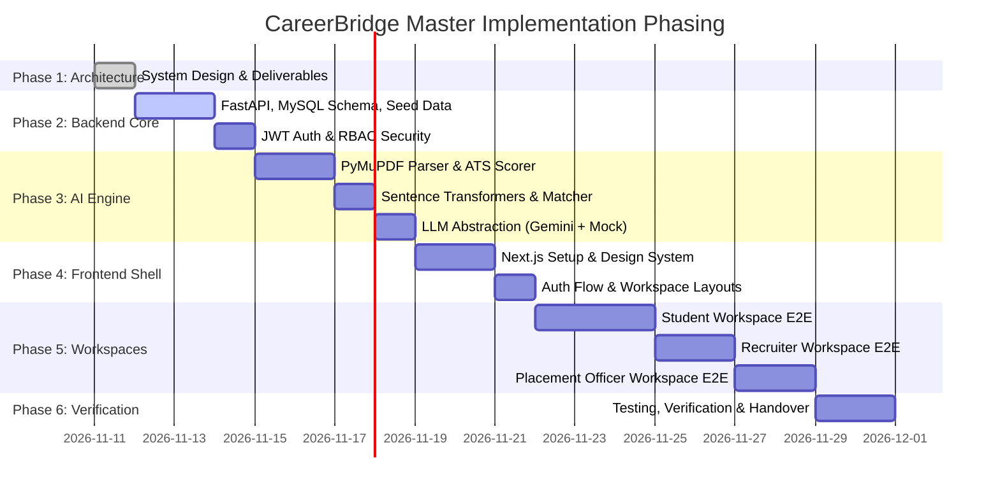

# CareerBridge — Development Roadmap & Technical Decisions

> **Project:** CareerBridge (*From Potential to Placement*)  
> **Architecture Phase:** Master Implementation Plan & Engineering Specifications

---

## 1. Complete Proposed Project Directory Structure

```
project1/
├── docs/                                  # Architectural & Technical Specifications
│   ├── architecture.md                    # System Topology & Security Model
│   ├── database-design.md                 # 32 MySQL Schemas, ER Diagrams & Constraints
│   ├── api-design.md                      # REST Endpoints, Payloads & Envelopes
│   ├── ai-architecture.md                 # AI Pipelines, Rubrics & LLM Integration
│   └── development-roadmap.md             # This document
│
├── backend/                               # FastAPI Asynchronous Application
│   ├── app/
│   │   ├── __init__.py
│   │   ├── main.py                        # FastAPI entry point, CORS, lifespan
│   │   ├── api/                           # REST API Controllers
│   │   │   ├── __init__.py
│   │   │   ├── deps.py                    # Auth & DB session dependencies
│   │   │   └── v1/
│   │   │       ├── __init__.py
│   │   │       ├── auth.py                # Login, register, refresh
│   │   │       ├── students.py            # Profile, skills, projects, applications
│   │   │       ├── resumes.py             # Upload, download, ATS analysis
│   │   │       ├── jobs.py                # Job catalog, search, bookmarks
│   │   │       ├── applications.py        # Candidate application pipeline
│   │   │       ├── ai.py                  # ATS, match score, skill gap, roadmaps, chat
│   │   │       ├── recruiters.py          # Recruiter company, jobs, applicant ranking
│   │   │       ├── admin.py               # TPO drives, batch stats, recruiter verification
│   │   │       └── notifications.py       # User alerts & announcements
│   │   ├── core/                          # Infrastructure & Settings
│   │   │   ├── __init__.py
│   │   │   ├── config.py                  # Pydantic BaseSettings (.env loading)
│   │   │   ├── database.py                # SQLAlchemy 2.0 engine & session maker
│   │   │   ├── security.py                # Passlib bcrypt & PyJWT implementation
│   │   │   └── permissions.py             # Role-based access guards (RBAC)
│   │   ├── models/                        # SQLAlchemy 2.0 ORM Mappings
│   │   │   ├── __init__.py
│   │   │   ├── base.py                    # Common Base with timestamp mixins
│   │   │   ├── user.py                    # Users & roles
│   │   │   ├── student.py                 # Student profile, academics, skills, projects
│   │   │   ├── recruiter.py               # Companies & recruiter profiles
│   │   │   ├── job.py                     # Jobs, job skills, job eligibility, saved jobs
│   │   │   ├── application.py             # Applications, status history, interviews
│   │   │   ├── resume.py                  # Resumes, versions, analysis
│   │   │   ├── ai.py                      # Match results, gap analysis, roadmaps, chat
│   │   │   ├── drive.py                   # Placement drives & student registrations
│   │   │   └── notification.py            # Notifications & audit logs
│   │   ├── schemas/                       # Pydantic v2 Request/Response DTOs
│   │   │   ├── __init__.py
│   │   │   ├── common.py                  # Envelopes, pagination, error schemas
│   │   │   ├── auth.py                    # Login, token, registration schemas
│   │   │   ├── student.py                 # Profile input/output schemas
│   │   │   ├── job.py                     # Job post & filter schemas
│   │   │   ├── application.py             # Application flow schemas
│   │   │   ├── resume.py                  # Resume & ATS score schemas
│   │   │   ├── ai.py                      # Match score, gap, roadmap, interview schemas
│   │   │   └── drive.py                   # Placement drive schemas
│   │   ├── services/                      # Application Business Logic Services
│   │   │   ├── __init__.py
│   │   │   ├── auth_service.py
│   │   │   ├── student_service.py
│   │   │   ├── job_service.py
│   │   │   ├── application_service.py
│   │   │   └── drive_service.py
│   │   └── ai/                            # Dedicated AI / ML Package
│   │       ├── __init__.py
│   │       ├── taxonomy.py                # Master skill taxonomy (800+ skills)
│   │       ├── resume_parser.py           # PyMuPDF text & section extractor
│   │       ├── ats_scorer.py              # 100-point rubric evaluator
│   │       ├── embeddings.py              # Sentence Transformers vector matcher
│   │       ├── skill_gap_engine.py        # Set delta & roadmap pathfinder
│   │       └── llm/                       # LLM Providers & Prompts
│   │           ├── __init__.py
│   │           ├── base.py                # Abstract BaseLLMProvider
│   │           ├── gemini.py              # Google Gemini API client
│   │           ├── mock_provider.py       # High-fidelity offline fallback provider
│   │           └── prompts.py             # System prompts for BridgeAI & Interviewer
│   ├── alembic/                           # Database Migration Scripts
│   │   ├── env.py
│   │   └── versions/
│   ├── tests/                             # Pytest Suite
│   │   ├── conftest.py
│   │   ├── test_auth.py
│   │   ├── test_ai_matching.py
│   │   └── test_ats_scorer.py
│   ├── storage/                           # Local Encrypted File System
│   │   └── resumes/
│   ├── scripts/
│   │   └── seed_demo_data.py              # Realistic sample data seeder
│   ├── alembic.ini
│   ├── requirements.txt
│   └── .env.example
│
├── frontend/                              # Next.js 14+ (App Router, TypeScript)
│   ├── public/                            # Static assets, branding, icons
│   ├── src/
│   │   ├── app/                           # App Router
│   │   │   ├── (auth)/
│   │   │   │   ├── login/page.tsx
│   │   │   │   └── register/page.tsx
│   │   │   ├── (student)/                 # Student Workspace
│   │   │   │   ├── dashboard/page.tsx
│   │   │   │   ├── profile/page.tsx
│   │   │   │   ├── resume/page.tsx        # ATS Scorer & Resume Builder
│   │   │   │   ├── jobs/page.tsx          # Job Discovery & Match Ranking
│   │   │   │   ├── applications/page.tsx  # Application Tracker
│   │   │   │   ├── skill-gap/page.tsx     # Gap Analysis & Roadmaps
│   │   │   │   ├── bridge-ai/page.tsx     # Career Chatbot
│   │   │   │   └── interview-prep/page.tsx# Mock Interview Simulator
│   │   │   ├── (recruiter)/               # Recruiter Workspace
│   │   │   │   ├── dashboard/page.tsx
│   │   │   │   ├── jobs/page.tsx          # Job Studio
│   │   │   │   ├── pipeline/page.tsx      # Kanban ATS Pipeline
│   │   │   │   └── candidates/page.tsx    # Talent Search
│   │   │   ├── (tpo)/                     # Placement Officer Workspace
│   │   │   │   ├── dashboard/page.tsx     # Macro Analytics
│   │   │   │   ├── students/page.tsx      # Student Directory & Approvals
│   │   │   │   ├── drives/page.tsx        # Drive Coordinator
│   │   │   │   └── broadcasts/page.tsx    # Announcement Dispatcher
│   │   │   ├── layout.tsx
│   │   │   └── page.tsx                   # Landing Page
│   │   ├── components/                    # Reusable UI Architecture
│   │   │   ├── ui/                        # Button, Input, Modal, Badge, Card, Progress
│   │   │   ├── shared/                    # Navbar, Sidebar, NotificationDropdown
│   │   │   ├── student/                   # ATSScoreWheel, SkillBadge, RoadmapTimeline
│   │   │   ├── recruiter/                 # KanbanBoard, CandidateCard
│   │   │   └── charts/                    # PlacementRateChart, CTCBandHistogram
│   │   ├── lib/
│   │   │   ├── api.ts                     # Axios/Fetch client with JWT interceptors
│   │   │   └── utils.ts                   # Formatting, cn helper
│   │   ├── hooks/
│   │   │   ├── useAuth.ts
│   │   │   └── useNotifications.ts
│   │   └── types/                         # TypeScript DTOs matching backend
│   ├── tailwind.config.js
│   ├── tsconfig.json
│   ├── package.json
│   └── .env.local.example
│
└── README.md
```

---

## 2. Technical Decisions & Technology Rationales

### Why Each Technology Was Selected:
1. **Next.js 14+ (App Router, React, TypeScript):**
   - Enables fast initial page rendering, static landing pages, and dynamic client-side SPA workspaces for logged-in users.
   - Built-in route grouping `(student)`, `(recruiter)`, `(tpo)` cleanly isolates workspace layouts without leaking styling.
2. **Tailwind CSS & Framer Motion:**
   - Zero-runtime overhead utility styling for rapid UI development with consistent color tokens. Framer Motion provides fluid, professional UI transitions (e.g., Kanban card drags, score wheel animations).
3. **FastAPI & Pydantic v2:**
   - High-throughput asynchronous performance on Python 3.10+.
   - Pydantic v2 provides compiled C-level request validation and schema generation, cutting serialization latency by 5x.
   - Native integration with Python's AI/ML ecosystem (NumPy, Scikit-learn, Sentence Transformers).
4. **MySQL 8.0 & SQLAlchemy 2.0:**
   - Proven relational consistency, strict foreign keys, and enterprise ACID transactions needed for placement and eligibility rules.
   - Robust native JSON support allows storing extracted skill arrays and ATS breakdown rubrics without secondary databases.
5. **Sentence Transformers (`all-MiniLM-L6-v2`):**
   - High-speed, 384-dimensional dense semantic representations.
   - Runs efficiently on CPU (inference takes < 50ms per resume/JD) with zero token cost.

### Which Technologies Are Optional:
- **Redis:** Can be introduced later for distributed token blacklisting or multi-node Celery task scheduling. In early and single-instance deployments, FastAPI's built-in `BackgroundTasks` and MySQL are fully sufficient.
- **pgvector:** Not required. By caching embeddings in an in-memory NumPy matrix, MySQL 8 effortlessly handles thousands of job postings and candidate vectors with sub-second cosine similarity lookups.

### Which Integrations Require External API Keys:
- **Google Gemini API (`GEMINI_API_KEY`):** Required only for live generative responses in BridgeAI and personalized narrative interview feedback.

### Which Features Work 100% Without Paid APIs:
- **Resume Parsing:** 100% free and local (`PyMuPDF`).
- **ATS Scoring:** 100% free and local (deterministic 100-point rubric).
- **Skill Extraction:** 100% free and local (custom taxonomy & n-gram matcher).
- **Semantic Job Matching:** 100% free and local (`Sentence Transformers` + Cosine Similarity).
- **Skill Gap Analysis:** 100% free and local (set delta & competency graphs).
- **Offline Mock AI Provider:** Both BridgeAI and Mock Interview simulator feature an offline fallback provider (`MockLLMProvider`) that yields structured, realistic feedback without requiring an API key.

### How to Maintain the Project as It Grows:
1. **Clean Code & Layering:** Controllers (`api/v1/`) contain zero business logic; they only validate DTOs and call Service classes.
2. **Deterministic Database Migrations:** Every schema alteration is versioned through Alembic migrations (`alembic revision --autogenerate`).
3. **Automated Test Coverage:** Unit and integration tests verify every API endpoint, ATS scoring calculation, and authorization check before deployment.
4. **Environment Isolation:** All configuration parameters are strictly managed via `.env` files using Pydantic's `BaseSettings`.

---

## 3. Development Phasing & Milestones



| Phase | Milestone | Acceptance Criteria |
| :---: | :--- | :--- |
| **Phase 1** | **System Architecture & Design** *(Current)* | All 5 deliverables created in `/docs`, complete 32-table schema, REST specs, AI pipelines, and folder structure. |
| **Phase 2** | **Backend Core & Database Layer** | MySQL connected with SQLAlchemy 2.0; all 32 tables generated via Alembic; JWT auth working for Student, Recruiter, TPO; realistic seed script populates demo data. |
| **Phase 3** | **AI / ML Engine Services** | `PyMuPDF` extracts clean text; ATS scorer accurately evaluates 100-point rubric; Sentence Transformers generates 384-d vectors; cosine similarity produces accurate match %; LLM provider switches seamlessly between Gemini and Mock. |
| **Phase 4** | **Frontend Core & Workspace Shells** | Next.js 14+ initialized; Tailwind CSS theme styled; layout wrappers for Student, Recruiter, and TPO created; JWT interceptors manage auth state. |
| **Phase 5** | **Workspace Implementation** | **Student:** Profile, ATS score card, Job discovery with match badge, 1-click apply, Skill gap & roadmap graph, BridgeAI chat.<br/>**Recruiter:** Job studio, Kanban pipeline, candidate search.<br/>**TPO:** Macro placement charts (Recharts), Drive creation, student verification, broadcast alerts. |
| **Phase 6** | **Testing & System Verification** | Automated Pytest suite passing; end-to-end recruitment cycle verified in browser; zero credential leaks. |

