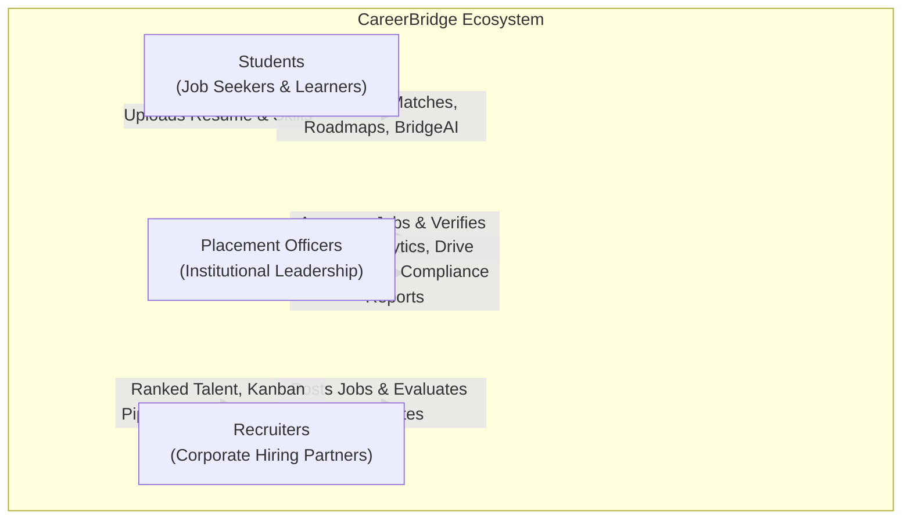

# CareerBridge — Project Overview

> **Tagline:** *From Potential to Placement.*  
> **Platform Version:** 1.0.0 (Production Ready)  
> **Target Audience:** University Students, Corporate Recruiters, and University Placement Officers (TPOs)  
> **Core Technology:** Next.js 14 (App Router) + FastAPI 4-Worker Cluster + MySQL 8.0 Enterprise + Embedded AI Engine  

---

## 1. Executive Vision & Problem Statement

Traditional university campus recruitment suffers from systemic inefficiencies that negatively impact students, hiring teams, and academic institutions:
1. **Opaque Resume Rejections:** Students submit resumes into third-party Applicant Tracking Systems (ATS) with no visibility into why their applications failed, which keywords were missing, or how formatting impacted machine parsing.
2. **Superficial Job Matching:** Conventional job boards rely on crude keyword filters that overlook transferable skills, candidate academic standing, backlogs, and semantic relevance, causing recruiters to drown in unqualified applicants while qualified students are overlooked.
3. **Absence of Actionable Roadmaps:** When students discover they lack critical industry competencies, they receive no structured guidance on how to bridge those gaps before recruitment season begins.
4. **Administrative Overhead for Universities:** Placement offices rely on fragmented spreadsheets to track hundreds of students, verify company credentials, manage on-campus drives, and report placement metrics to institutional accreditation bodies.

**CareerBridge solves these challenges through an integrated, AI-driven recruitment and career intelligence platform.** By uniting students, recruiters, and placement directors within a shared, high-trust ecosystem, CareerBridge accelerates candidate readiness and streamlines enterprise campus hiring.

---

## 2. Core Stakeholders & Value Propositions

### 2.1 For Students
- **Transparent ATS Diagnostics:** Instant 100-point rubric evaluation across 7 distinct dimensions (Structure, Skills, Projects, Experience, Education, Achievements, Readability) with actionable verb density analysis and downloadable PDF audit reports.
- **Multi-Tier Algorithmic Job Radar:** Matches candidate competencies against campus openings using exact keyword intersection, weighted importance scoring, and dense semantic embeddings.
- **Skill Gap Diagnosis & Dynamic Roadmaps:** Compares current capabilities against 9 industry standard roles (plus custom synthesized roles) to generate 6-stage milestone roadmaps with verifiable project evidence.
- **BridgeAI Career Mentor:** Context-aware, retrieval-grounded conversational assistant that references only authorized student data to advise on interview prep, salary expectations, and skill acquisition.
- **AI Interview Practice Studio:** Realistic voice-to-text simulation generating domain-specific technical and behavioral questions evaluated across 6 rubrics.

### 2.2 For Corporate Recruiters
- **Company Verification & Trust:** Streamlined registration with institutional authorization gates preventing unauthorized job postings.
- **AI-Assisted Job Studio:** High-speed job description drafting with structured required/preferred skill tagging, CGPA cutoffs, and departmental filters.
- **Algorithmic Candidate Ranking:** Automatic compatibility scoring ordering applicants by qualification rather than application timestamp.
- **Interactive Kanban Pipeline:** 5-stage recruitment stream (Applied $\to$ Shortlisted $\to$ Technical Round $\to$ HR Round $\to$ Offered) with immutable audit logging and status timestamps.
- **Standardized Interview Rubrics:** Multi-dimensional feedback capture ensuring uniform evaluation standards across candidate pools.

### 2.3 For University Placement Officers (TPOs)
- **Executive Command Center:** Real-time macro dashboards reporting overall placement rates, average/highest CTC packages, and department breakdown charts.
- **Bulk Student Directory Management:** CSV import with automatic field mapping and duplicate record detection.
- **Institutional Governance:** Recruiter vetting, job posting approval controls, and suspension capabilities to safeguard student data.
- **Placement Drive Coordination:** Campus schedule manager linking recruiters, eligible student cohorts, interview venues, and registration deadlines.
- **Accreditation-Ready Reporting:** Exportable placement summaries and compliance metrics formatted for regulatory audits.

---

## 3. High-Level Functional Feature Matrix

| Functional Module | Primary User | Core Capabilities | Underlying Tech |
| :--- | :---: | :--- | :--- |
| **Authentication & RBAC** | All Personas | Argon2id hashing, HttpOnly Secure cookies, refresh token rotation, brute-force defense | `argon2-cffi`, `pyjwt`, FastAPI deps |
| **Profile & Resume Intelligence** | Student | Dynamic 7-pillar completion (0-100%), PyMuPDF parser, multi-resume management | `pymupdf`, `python-docx`, SQLAlchemy |
| **Job Discovery & Matching** | Student | Hybrid matching engine (Exact, Weighted, Semantic Vector), eligibility verification | Scikit-learn, Sentence Transformers |
| **ATS Resume Analyzer** | Student | 100-point transparent rubric, action verb density, downloadable PDF reports | PyMuPDF Canvas, custom scoring |
| **Career Roadmap & CRI** | Student | 9 target roles, 6-stage progress tracker, transparent Career Readiness Index | Curated role taxonomy, SVG rings |
| **BridgeAI Career Assistant** | Student | Student-isolated RAG context, prompt injection defense, career advice | Gemini 1.5 Flash, MockLLM fallback |
| **Recruiter Talent Hub** | Recruiter | AI requisition drafting, candidate ranking, Kanban pipeline, interview rubrics | FastAPI REST, Next.js Drag/Drop |
| **TPO Command Center** | Placement Officer | Bulk CSV import, recruiter vetting, drive calendar, institutional analytics | Recharts, SQLAlchemy aggregation |
| **Interview Practice Studio** | Student | Voice recording via Web Speech API, dynamic questions, 6-dimension rubric | Web Speech API, Gemini evaluation |
| **Notification Hub** | All Personas | In-app notification center, real-time unread badges, email alerts | DB-driven messaging, SMTP relay |

---

## 4. Key Architectural Guarantees

1. **Strict Production Environment Isolation:**
   - In `production`, `DEBUG=False`, `COOKIE_SECURE=True`, and `ENABLE_DB_FALLBACK=False` are non-negotiable invariants.
   - If MySQL fails in production, the application will not silently switch to local SQLite; it logs an immediate fatal error to prevent state divergence.
2. **Zero-Secret Codebase:**
   - Sensitive credentials (JWT secrets, DB passwords, API keys) are strictly injected via runtime environment variables and never checked into source control.
3. **Data Integrity & Normalization:**
   - 32 relational tables normalized to 3NF/BCNF with UUID v4 primary keys and explicit foreign key cascading rules.
4. **Type-Safe Full-Stack Contract:**
   - Backend responses are strictly typed via Pydantic v2 schemas; frontend interfaces mirror these contracts via TypeScript interfaces, maintaining 0 compilation errors across 37 routes.

