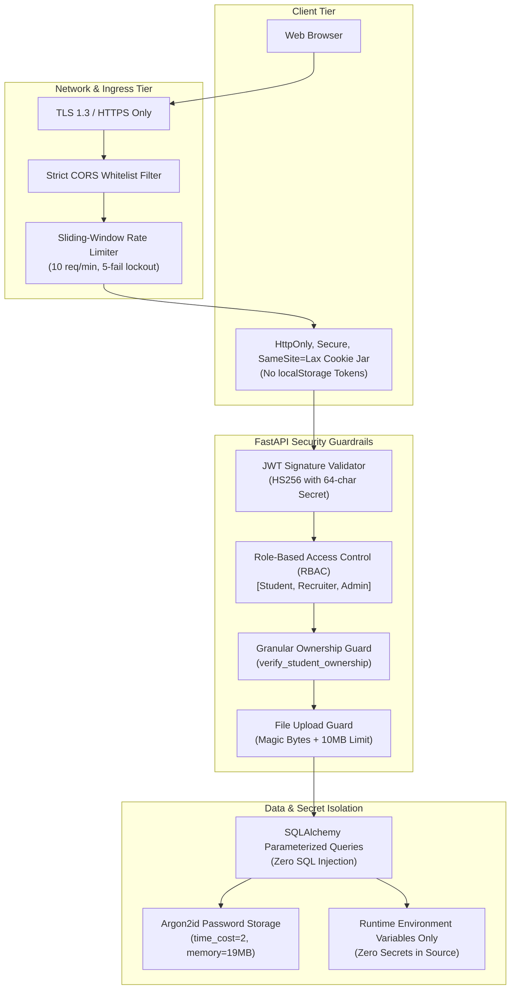

# CareerBridge — Security Architecture & Threat Model

> **Platform Version:** 1.0.0  
> **Security Baseline:** OWASP Top 10 Compliance, Defense in Depth, Zero Trust Resource Ownership  
> **Cryptographic Primitives:** Argon2id (`argon2-cffi`), HMAC-SHA256 (JWT), SHA-256 Token Hashes  

---

## 1. Security Architecture Overview

CareerBridge implements defense-in-depth security spanning authentication, session management, resource authorization, input validation, cryptographic hashing, and production environment hardening.



---

## 2. Authentication & Credential Security

### 2.1 Argon2id Password Hashing with Transparent Upgrade
Passwords are never stored in plaintext. They are hashed using **Argon2id**, the winner of the Password Hashing Competition (PHC), configured with memory-hard parameters resisting GPU/ASIC brute force attacks:
- `time_cost = 2`
- `memory_cost = 19456` (19 MB)
- `parallelism = 1`
- `hash_len = 32`

**Legacy Migration:** To ensure zero disruption for legacy users hashed with bcrypt (`$2b$`), the authentication service transparently verifies bcrypt hashes upon login and automatically re-hashes the user's password with Argon2id in the database before completing the session.

### 2.2 Token Storage in HttpOnly Cookies
To defend against Cross-Site Scripting (XSS) credential theft:
- **Zero Tokens in `localStorage` or `sessionStorage`:** Access and refresh tokens are strictly disallowed from being stored in client-accessible storage.
- **HttpOnly & Secure:** Tokens are set via HTTP response headers with `HttpOnly=True` (inaccessible to JavaScript `document.cookie`), `Secure=True` (transmitted exclusively over HTTPS), and `SameSite=Lax` (defends against Cross-Site Request Forgery).

### 2.3 Refresh Token Rotation & Replay Attack Defense
1. Whenever `/api/v1/auth/refresh` is called, the old refresh token is immediately invalidated.
2. A new token pair is issued and a unique SHA-256 hash of the new refresh token is saved in the `refresh_tokens` database table.
3. If a compromised or revoked refresh token is resubmitted (indicating a token replay attack), the system flags the breach and **immediately revokes all active sessions** for that user.

---

## 3. Authorization & Resource Ownership Guards

### 3.1 Role-Based Access Control (RBAC)
FastAPI dependencies enforce strict persona separation:
- `require_roles(["student"])`: Protects student profile editing, resume uploads, and job applications.
- `require_roles(["recruiter"])`: Protects job publishing, candidate pipeline management, and interview scheduling.
- `require_roles(["admin"])`: Protects university administration, recruiter verification, and batch student imports.

### 3.2 Controlled Administrator Provisioning
Public administrator registration via `/api/v1/auth/register` is **strictly forbidden (HTTP 403)**. New university placement administrators can only be created via:
- Direct CLI execution using `backend/scripts/create_admin.py` on the secure server host.
- A cryptographically signed, single-use `admin_invitation_token`.

### 3.3 Ownership Verification
Role membership alone is insufficient. Resource ownership guards prevent Insecure Direct Object References (IDOR):
```python
def verify_student_ownership(student_id: str, current_user: User):
    if current_user.role != UserRole.ADMIN and current_user.id != student_id:
        raise HTTPException(status_code=403, detail="Forbidden: You cannot access another student's record.")
```

---

## 4. File Upload & Storage Security

Uploaded candidate resumes represent a common attack vector (malicious executables, disguised scripts, zip bombs). CareerBridge enforces multi-tier defense:

1. **Size Hard Cap:** Upload payloads are strictly capped at **10MB**. Oversized requests are rejected immediately with `HTTP 413 Payload Too Large`.
2. **Magic Byte Inspection:** File extensions (`.pdf`, `.docx`) are not trusted. The backend inspects binary headers directly:
   - PDF: Must start with `%PDF-` (`0x25 0x50 0x44 0x46 0x2D`).
   - DOCX: Must start with zip magic bytes `PK\x03\x04`.
3. **Storage Sanitization:** Resumes are saved using randomly generated UUID filenames on persistent storage volumes outside the web root (`/app/storage/resumes`), preventing path traversal and direct URL execution.

---

## 5. Production Hardening & Invariants

In `production` mode, the `backend/app/core/config.py` module enforces non-negotiable invariants:

| Parameter | Invariant Value | Security Enforcement |
| :--- | :---: | :--- |
| `DEBUG` | `False` | Prevents exposing interactive traceback debuggers and internal server paths. |
| `COOKIE_SECURE` | `True` | Rejects plain HTTP transmission; enforces HTTPS for all cookie tokens. |
| `ENABLE_DB_FALLBACK` | `False` | Forbids silent fallback to local SQLite; guarantees high-integrity MySQL data persistence. |
| `poweredByHeader` | `false` | Disabled in `next.config.js` to prevent framework fingerprinting. |
| `USER` | Non-root | Both frontend and backend Dockerfiles execute under unprivileged user accounts (`careerbridge` UID 1000, `nextjs` UID 1001). |

