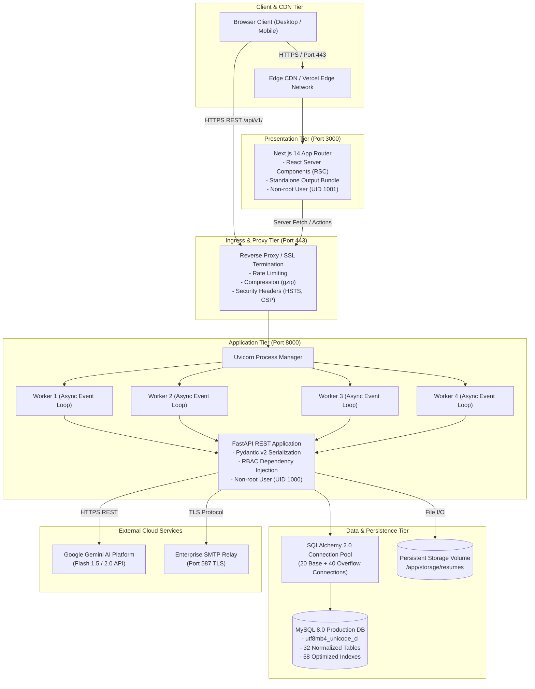
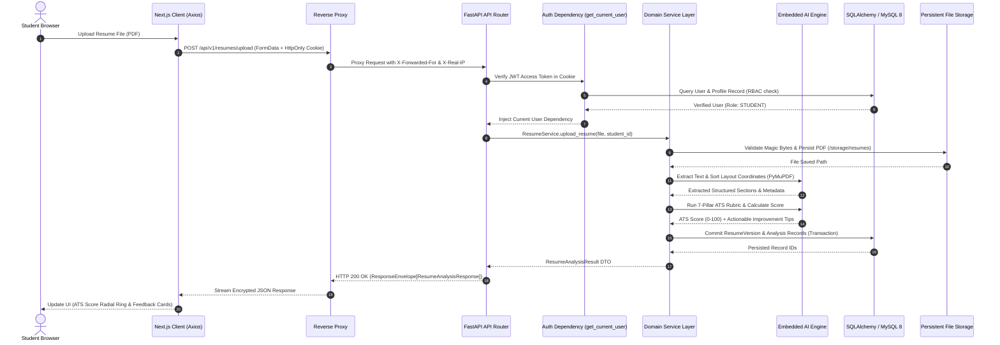

# CareerBridge — System Architecture Specification

> **Platform Version:** 1.0.0  
> **Topology:** Decoupled Micro-Modular Full-Stack SaaS  
> **Primary Runtime:** Next.js 14 (Node.js 20) + FastAPI (Python 3.11+) + MySQL 8.0 Enterprise  

---

## 1. System Topology & Infrastructure Layout

CareerBridge is designed around a decoupled, layered architectural pattern. The user interface runs as an independent Next.js 14 application on edge/container infrastructure, communicating securely with an asynchronous FastAPI application cluster fronted by an SSL/TLS terminating reverse proxy.



---

## 2. End-to-End Request Lifecycle

The diagram below illustrates how an authenticated request (such as uploading a resume or triggering job matching) flows through the complete system:



---

## 3. Backend Architecture & Layered Modular Structure

The backend is structured strictly into modular layers adhering to separation of concerns:

```
backend/app/
├── api/
│   ├── deps.py              # Inversion of Control: DB session & RBAC dependencies
│   └── v1/                  # Versioned API route controllers
│       ├── auth.py          # Registration, login, token refresh, logout
│       ├── students.py      # Profile, academic records, skills, projects
│       ├── resumes.py       # Upload, parsing, ATS scoring, PDF report export
│       ├── jobs.py          # Job discovery, matching engine, radar
│       ├── applications.py  # Application lifecycle, status progression
│       ├── recruiter.py     # Job creation, candidate pipeline, interview scheduling
│       ├── admin.py         # Institutional analytics, bulk import, drive management
│       ├── bridge_ai.py     # Conversational career mentor endpoint
│       ├── interview_prep.py# Voice-to-text practice simulations & scoring
│       └── notifications.py # Real-time notification center
├── core/
│   ├── config.py            # Pydantic Settings with production invariants
│   ├── database.py          # SQLAlchemy 2.0 engine, connection pool, sessionmaker
│   └── security.py          # Argon2id password hashing, JWT encoding/decoding
├── models/                  # 32 SQLAlchemy ORM models with UUID primary keys
├── schemas/                 # Pydantic v2 validation DTOs and ResponseEnvelope
├── services/                # Encapsulated business logic transactions
└── ai/                      # Domain-specific AI/ML algorithms
    ├── resume_analyzer/     # PyMuPDF text extractor, 100-point rubric, PDF exporter
    ├── job_matcher/         # Exact, weighted, and dense semantic vector matchers
    ├── skill_gap/           # Role taxonomy comparator & roadmap synthesis
    ├── interview_prep/      # Question generator & 6-dimension evaluation rubric
    └── bridge_ai/           # RAG context retriever & Gemini LLM adapter
```

### Architectural Principles:
1. **Dependency Injection (IoC):** Routes never instantiate database sessions or business services directly. Database sessions (`get_db`) and authenticated contexts (`get_current_user`, `require_roles`) are injected via FastAPI dependencies.
2. **Transactional Boundaries:** Database writes are wrapped in atomic transactions within the service layer. If an external service or file operation fails, the transaction rolls back cleanly.
3. **Response Envelope Pattern:** All endpoints return a standardized, uniform response wrapper:
   ```json
   {
     "success": true,
     "message": "Operation completed successfully",
     "data": { ... },
     "meta": {
       "timestamp": "2026-11-12T12:00:00Z",
       "request_id": "req_uuid4"
     }
   }
   ```

---

## 4. Frontend Architecture & Component Geometry

The frontend leverages Next.js 14 App Router, React Server Components where beneficial, and Client Components for dynamic dashboards and interactive SVG visualizations.

### 4.1 Layout Hierarchy
- **`WorkspaceShell`:** Persistent responsive layout housing the role-specific sidebar, top notification bar, mobile menu drawer, and active user profile indicator.
- **Role Isolation:**
  - `/student/*`: Student career workspace.
  - `/recruiter/*`: Corporate recruiter talent hub.
  - `/admin/*`: University Placement Officer (TPO) command center.

### 4.2 Signature Math-Driven SVG Components
Rather than relying on generic UI charts, CareerBridge implements bespoke components calculated with geometric trigonometry and SVG math:
1. **`CareerReadinessRing`:** Concentric multi-tier radial progress SVG visualizing 4 weighted sub-pillars (Resume Health 30%, Skill Coverage 30%, Interview Prep 20%, Academic Eligibility 20%).
2. **`OpportunityRadar`:** Custom 5-axis pentagon vector radar plotting candidate competencies against Tier-1 campus hiring benchmarks.
3. **`ApplicationPipeline`:** High-density Kanban recruitment stream with status progression buttons and stage counters.
4. **`SkillConstellation`:** Interactive categorized ontology matrix showing verified student skills alongside market demand percentages.

---

## 5. Concurrency, Connection Pooling & Resilience

| Parameter | Configuration | Technical Rationale |
| :--- | :--- | :--- |
| **Server Engine** | Uvicorn (ASGI) | Async event-loop handling thousands of concurrent idle I/O connections. |
| **Worker Model** | 4 Worker Processes | Maximizes CPU multi-core utilization on multi-core servers/containers. |
| **DB Pool Size** | `DATABASE_POOL_SIZE = 20` | Base persistent open connections shared across worker threads. |
| **DB Max Overflow** | `DATABASE_MAX_OVERFLOW = 40` | Burst buffer handling peak campus placement traffic spikes (up to 60 total). |
| **DB Pool Recycle** | `DATABASE_POOL_RECYCLE = 1800` | Refreshes idle connections every 30 minutes to prevent MySQL timeout disconnections. |
| **Timeouts** | `timeout = 10000ms` (Client) | Prevents slow client queries from hanging worker threads. |
| **Fail-Fast Invariant** | `ENABLE_DB_FALLBACK = False` | Strictly enforces fatal error if MySQL fails in production; avoids split-brain SQLite. |

