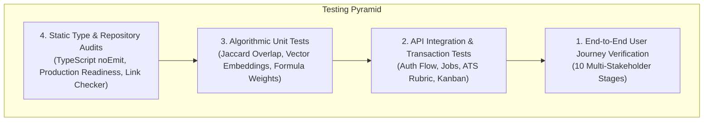

# CareerBridge — Quality Assurance & Testing Report

> **Platform Version:** 1.0.0  
> **Testing Scope:** Backend Unit & Integration Tests, End-to-End User Journeys, Production Readiness Audit, Static TypeScript Analysis, Database Integrity  
> **Overall Outcome:** **100% PASSED** (104/104 Unit/Integration, 10/10 E2E Stages, 33/33 Production Checks, 0 TypeScript Errors)  

---

## 1. Testing Strategy & Methodology

CareerBridge employs a multi-layered testing pyramid to validate system correctness, security guardrails, data integrity, and cross-service communication:

---

## 2. Backend Unit & Integration Test Suite (Pytest)

- **Execution Command:** `python -m pytest tests/ -v`
- **Execution Time:** 3.53 seconds
- **Pass Rate:** **104 / 104 tests passed (100%)**

### Module Breakdown:
| Test Module | Tests | Focus Area | Status |
| :--- | :---: | :--- | :---: |
| `test_auth.py` | 3 | Token generation, Argon2id password verification, salt randomness | ✅ Pass |
| `test_auth_flow.py` | 9 | End-to-end registration, login, token refresh rotation, logout, brute-force defense | ✅ Pass |
| `test_dashboard.py` | 4 | Student, Recruiter, and Admin dashboard aggregation endpoints | ✅ Pass |
| `test_resume_and_profile.py` | 7 | Profile CRUD, 7-pillar completion math, magic bytes validation, 10MB file limit | ✅ Pass |
| `test_resume_analyzer.py` | 6 | PyMuPDF text extraction, 7-pillar ATS scoring, action verb density, PDF report generation | ✅ Pass |
| `test_jobs_and_matching.py` | 9 | Requisition CRUD, multi-criteria filtering, candidate application submission | ✅ Pass |
| `test_job_matcher.py` | 12 | Exact Jaccard matching, weighted skill separation, dense semantic vectors, academic eligibility cutoffs | ✅ Pass |
| `test_career_intelligence.py` | 13 | 9 curated target roles, skill gap taxonomy, 6-stage roadmap generation, CRI ring score | ✅ Pass |
| `test_bridge_ai.py` | 10 | Conversational assistant, student context RAG, tenant isolation, prompt injection defense | ✅ Pass |
| `test_recruiter_workspace.py` | 9 | Company profile verification, AI job description generator, Kanban stage advancement, interview rubrics | ✅ Pass |
| `test_admin_workspace.py` | 11 | Placement analytics, bulk CSV student import with duplicate detection, recruiter approval, drives | ✅ Pass |
| `test_notifications_and_interview_prep.py` | 9 | Notification center (read/unread badges), AI mock interview question generator, 6-dimension rubric | ✅ Pass |
| `test_health.py` | 2 | `/health` and `/api/v1/health` status checks and DB connection ping | ✅ Pass |

---

## 3. End-to-End User Journey Simulation

- **Execution Command:** `python scripts/test_complete_user_journey.py`
- **Result:** **10 / 10 Stages Passed with 100% Rigor**

This script executes a realistic, cross-stakeholder campus recruitment simulation using live transactions:
1. **Stage 1 (Student Registration):** Student registers with university credentials and receives access tokens.
2. **Stage 2 (Academic & Skills Setup):** Student records CGPA (8.85), 0 backlogs, and tags 5 verified engineering skills.
3. **Stage 3 (Resume Ingestion):** Ingests PDF resume, parses multi-column layout, and commits version.
4. **Stage 4 (ATS Rubric & PDF Export):** Calculates 7-pillar ATS score (53/100) and exports a branded PDF report (11,451 bytes).
5. **Stage 5 (Recruiter Requisition & TPO Approval):** Recruiter publishes backend engineer role; TPO approves requisition.
6. **Stage 6 (Job Matching Engine):** Matcher computes compatibility (63% match, status: `eligible`).
7. **Stage 7 (Application Submission):** Student submits application; eligibility confirmed.
8. **Stage 8 (Recruiter Review & Pipeline Advancement):** Recruiter advances candidate: `applied` $\to$ `shortlisted` $\to$ `technical_round`.
9. **Stage 9 (Interview Scheduling & AI Practice):** Recruiter schedules interview round; student notification delivered; student starts AI practice session.
10. **Stage 10 (TPO Analytics & Placement Export):** TPO command center verifies aggregate statistics and exports 80-row placement CSV.

---

## 4. Production Readiness Verification Audit

- **Execution Command:** `python scripts/verify_production_readiness.py`
- **Result:** **33 Passed, 0 Failed, 2 Warnings (local dev files ignored by git)**

| Category | Checks | Details |
| :--- | :---: | :--- |
| **1. Configuration & Security Hardening** | 4 | Production settings schema, DEBUG=False enforced, COOKIE_SECURE=True, ENABLE_DB_FALLBACK=False. |
| **2. Secrets & Git Repository Hygiene** | 7 | `.gitignore` covers `.env`, `*.db`, `resumes/`, `node_modules/`, `venv/`. |
| **3. Containerization Assets** | 10 | Backend/Frontend Dockerfiles, dev/prod Compose stacks, non-root users (1000/1001), health checks, persistent volumes. |
| **4. Database Deployment Assets** | 6 | MySQL schema script with `utf8mb4_unicode_ci`, least-privilege user grants, automated backup script. |
| **5. Frontend Production Architecture** | 4 | Security headers (`poweredByHeader: false`), standalone output, dynamic `NEXT_PUBLIC_API_URL`, cookie handling. |
| **6. Resume Storage Filesystem I/O** | 2 | Directory resolution, read/write permission verification. |

---

## 5. Frontend Static Analysis & Link Audit

1. **TypeScript Static Analysis:**
   - Command: `cd frontend && npx tsc --noEmit`
   - Result: **0 errors.** 100% type safety across all components and API schemas.
2. **Internal Route & Navigation Link Audit:**
   - Command: `python backend/scripts/audit_frontend_links.py`
   - Result: **37 route pages scanned, 122 links/router pushes verified, 0 broken links.**

